# 第十一章 面向对象编程（下）与魔术方法

## 一、魔法方法（特殊方法）总览

魔法方法（Magic Methods）又称特殊方法（Special Methods）或 dunder methods（double underscore methods），是 Python 中以双下划线开头和结尾的方法。它们由 Python 解释器在特定场景下自动调用，用于实现对象的**运算符重载**、**协议实现**和**内置行为定制**。

### (1) 对象生命周期

#### 1.1 `__new__`：创建实例

在实例创建时最先调用，负责**创建并返回**实例对象。第一个参数是 `cls`。

```python
class Singleton:
    _instance = None

    def __new__(cls, *args, **kwargs):
        if cls._instance is None:
            cls._instance = super().__new__(cls)
        return cls._instance

a = Singleton()
b = Singleton()
print(a is b)   # True
```

#### 1.2 `__init__`：初始化实例

在 `__new__` 返回实例后调用，负责**初始化**实例属性。第一个参数是 `self`，必须返回 `None`。

```python
class Person:
    def __init__(self, name, age):
        self.name = name
        self.age = age

p = Person("Alice", 25)
```

#### 1.3 `__del__`：析构方法

对象被垃圾回收时调用，用于资源清理。调用时机不确定，不应用于关键资源释放。

```python
class Resource:
    def __del__(self):
        print("资源被销毁")

r = Resource()
del r   # 资源被销毁
```

#### 1.4 `__init_subclass__`：子类创建时调用

在定义子类时自动调用，常用于注册子类或验证子类。

```python
class Plugin:
    plugins = []

    def __init_subclass__(cls, **kwargs):
        super().__init_subclass__(**kwargs)
        Plugin.plugins.append(cls)

class PluginA(Plugin): pass
class PluginB(Plugin): pass

print(Plugin.plugins)   # [<class 'PluginA'>, <class 'PluginB'>]
```

#### 1.5 `__set_name__`：描述符命名时调用

描述符被赋值给类属性时调用，接收 owner 类和属性名。

```python
class Field:
    def __set_name__(self, owner, name):
        self.name = name

    def __get__(self, obj, objtype=None):
        return obj.__dict__.get(self.name)

    def __set__(self, obj, value):
        obj.__dict__[self.name] = value

class Model:
    name = Field()
    age = Field()

m = Model()
m.name = "Alice"
print(m.name)   # Alice
```

### (2) 字符串表示

#### 2.1 `__str__`：用户友好的字符串

`str(obj)`、`print(obj)`、`f"{obj}"` 时调用，返回用户可读的字符串。

```python
class Point:
    def __init__(self, x, y):
        self.x = x
        self.y = y

    def __str__(self):
        return f"({self.x}, {self.y})"

print(Point(1, 2))   # (1, 2)
```

#### 2.2 `__format__`：格式化字符串

`format(obj, spec)`、`f"{obj:spec}"` 时调用。

```python
class Temperature:
    def __init__(self, celsius):
        self.celsius = celsius

    def __format__(self, spec):
        if spec == "f":
            return f"{self.celsius * 9/5 + 32:.1f}°F"
        return f"{self.celsius:.1f}°C"

t = Temperature(25)
print(f"{t}")    # 25.0°C
print(f"{t:f}")  # 77.0°F
```

#### 2.3 `__bytes__`：字节表示

`bytes(obj)` 时调用。

```python
class Message:
    def __init__(self, text):
        self.text = text

    def __bytes__(self):
        return self.text.encode("utf-8")

print(bytes(Message("hello")))   # b'hello'
```

### (3) 属性访问

#### 3.1 `__getattr__`：属性不存在时调用

只有当常规属性查找失败时才调用。

```python
class Dynamic:
    def __getattr__(self, name):
        return f"动态属性: {name}"

d = Dynamic()
print(d.foo)   # 动态属性: foo
print(d.bar)   # 动态属性: bar
```


#### 3.2 `__getattribute__`：所有属性访问时调用

每次访问属性都会调用，优先级最高。容易引发无限递归，需谨慎使用。

```python
class Demo:
    def __getattribute__(self, name):
        print(f"访问属性: {name}")
        return super().__getattribute__(name)

d = Demo()
d.x = 10
print(d.x)
# 访问属性: x
# 10
```

#### 3.3 `__setattr__`：设置属性时调用

每次设置属性都会调用。

```python
class ReadOnly:
    def __init__(self):
        object.__setattr__(self, "initialized", True)

    def __setattr__(self, name, value):
        if getattr(self, "initialized", False):
            raise AttributeError("对象是只读的")
        super().__setattr__(name, value)

r = ReadOnly()
# r.x = 10   # AttributeError: 对象是只读的
```

#### 3.4 `__delattr__`：删除属性时调用

```python
class Demo:
    def __delattr__(self, name):
        print(f"删除属性: {name}")
        super().__delattr__(name)

d = Demo()
d.x = 10
del d.x   # 删除属性: x
```

#### 3.5 `__dir__`：自定义 `dir()` 结果

```python
class Demo:
    def __dir__(self):
        return ["a", "b", "c"]

print(dir(Demo()))   # ['a', 'b', 'c']
```

### (4) 描述符协议

#### 4.1 `__get__`、`__set__`、`__delete__`

描述符用于控制属性访问，是 `property`、`classmethod`、`staticmethod` 的底层实现。

```python
class Positive:
    def __set_name__(self, owner, name):
        self.name = name

    def __get__(self, obj, objtype=None):
        if obj is None:
            return self
        return obj.__dict__.get(self.name)

    def __set__(self, obj, value):
        if value < 0:
            raise ValueError("必须为正数")
        obj.__dict__[self.name] = value

class Product:
    price = Positive()

    def __init__(self, price):
        self.price = price

p = Product(100)
print(p.price)   # 100
# p.price = -1   # ValueError
```

**分类**：

-   **数据描述符**：实现了 `__set__` 或 `__delete__`，优先级高于实例 `__dict__`。
-   **非数据描述符**：只实现 `__get__`，优先级低于实例 `__dict__`。

### (5) 容器与序列

#### 5.1 `__len__`：长度

`len(obj)` 时调用。

```python
class MyList:
    def __init__(self, data):
        self.data = data

    def __len__(self):
        return len(self.data)

print(len(MyList([1, 2, 3])))   # 3
```

#### 5.2 `__getitem__`：索引访问

`obj[key]` 时调用。

```python
class MyList:
    def __init__(self, data):
        self.data = data

    def __getitem__(self, index):
        return self.data[index]

ml = MyList([10, 20, 30])
print(ml[0])    # 10
print(ml[1:3])  # [20, 30]
```

#### 5.3 `__setitem__`：索引赋值

`obj[key] = value` 时调用。

```python
class MyList:
    def __init__(self):
        self.data = {}

    def __setitem__(self, key, value):
        self.data[key] = value

ml = MyList()
ml[0] = "a"
print(ml.data)   # {0: 'a'}
```


#### 5.4 `__delitem__`：索引删除

`del obj[key]` 时调用。

```python
class MyList:
    def __init__(self, data):
        self.data = list(data)

    def __delitem__(self, index):
        del self.data[index]

ml = MyList([1, 2, 3])
del ml[0]
print(ml.data)   # [2, 3]
```


#### 5.5 `__contains__`：`in` 运算符

`x in obj` 时调用。

```python
class MyList:
    def __init__(self, data):
        self.data = data

    def __contains__(self, item):
        return item in self.data

print(2 in MyList([1, 2, 3]))   # True
```

#### 5.6 `__iter__`：迭代器

`for x in obj` 时调用，返回迭代器。

```python
class MyList:
    def __init__(self, data):
        self.data = data

    def __iter__(self):
        return iter(self.data)

for x in MyList([1, 2, 3]):
    print(x)
```

#### 5.7 `__next__`：迭代器协议

与 `__iter__` 配合，定义迭代器的下一个值。

```python
class Countdown:
    def __init__(self, start):
        self.current = start

    def __iter__(self):
        return self

    def __next__(self):
        if self.current <= 0:
            raise StopIteration
        self.current -= 1
        return self.current + 1

for x in Countdown(3):
    print(x)   # 3 2 1
```

#### 5.8 `__reversed__`：`reversed()` 支持

```python
class MyList:
    def __init__(self, data):
        self.data = data

    def __reversed__(self):
        return reversed(self.data)

print(list(reversed(MyList([1, 2, 3]))))   # [3, 2, 1]
```

#### 5.9 `__missing__`：字典缺失键

用于 `dict` 的子类，当键不存在时调用。

```python
class DefaultDict(dict):
    def __missing__(self, key):
        return f"默认值({key})"

d = DefaultDict()
print(d["a"])   # 默认值(a)
```


### (6) 比较运算

#### 6.1 比较运算符

| 方法     | 运算符 |
| :------- | :----- |
| `__eq__` | `==`   |
| `__ne__` | `!=`   |
| `__lt__` | `<`    |
| `__le__` | `<=`   |
| `__gt__` | `>`    |
| `__ge__` | `>=`   |

python

```python
class Version:
    def __init__(self, major, minor):
        self.major = major
        self.minor = minor

    def __eq__(self, other):
        return (self.major, self.minor) == (other.major, other.minor)

    def __lt__(self, other):
        return (self.major, self.minor) < (other.major, other.minor)

v1 = Version(1, 0)
v2 = Version(2, 0)
print(v1 == v2)   # False
print(v1 < v2)    # True
print(v1 != v2)   # True（自动取反）
```


#### 6.2 `__hash__`：哈希值

用于 `hash(obj)`、集合、字典键。定义 `__eq__` 后，`__hash__` 会被设为 `None`，需显式定义。

```python
class Point:
    def __init__(self, x, y):
        self.x = x
        self.y = y

    def __eq__(self, other):
        return (self.x, self.y) == (other.x, other.y)

    def __hash__(self):
        return hash((self.x, self.y))

p1 = Point(1, 2)
p2 = Point(1, 2)
print(hash(p1) == hash(p2))   # True
print({p1, p2})               # {Point(1, 2)}
```


#### 6.3 `__bool__`：布尔值

`bool(obj)`、`if obj:` 时调用。

```python
class MyList:
    def __init__(self, data):
        self.data = data

    def __bool__(self):
        return len(self.data) > 0

print(bool(MyList([])))       # False
print(bool(MyList([1, 2])))   # True
```


### (7) 算术运算

#### 7.1 二元算术运算符

| 方法           | 运算符     |
| :------------- | :--------- |
| `__add__`      | `+`        |
| `__sub__`      | `-`        |
| `__mul__`      | `*`        |
| `__truediv__`  | `/`        |
| `__floordiv__` | `//`       |
| `__mod__`      | `%`        |
| `__pow__`      | `**`       |
| `__matmul__`   | `@`        |
| `__divmod__`   | `divmod()` |


```python
class Vector:
    def __init__(self, x, y):
        self.x = x
        self.y = y

    def __add__(self, other):
        return Vector(self.x + other.x, self.y + other.y)

    def __mul__(self, scalar):
        return Vector(self.x * scalar, self.y * scalar)

    def __repr__(self):
        return f"Vector({self.x}, {self.y})"

v1 = Vector(1, 2)
v2 = Vector(3, 4)
print(v1 + v2)      # Vector(4, 6)
print(v1 * 3)       # Vector(3, 6)
```

#### 7.2 反向算术运算符

当左操作数不支持运算时，Python 尝试右操作数的反向方法。

| 方法       | 运算符      |
| :--------- | :---------- |
| `__radd__` | `+`（反向） |
| `__rsub__` | `-`（反向） |
| `__rmul__` | `*`（反向） |
| ...        | ...         |


```python
class Vector:
    def __init__(self, x):
        self.x = x

    def __radd__(self, other):
        print("调用 __radd__")
        return Vector(other + self.x)

    def __repr__(self):
        return f"Vector({self.x})"

v = Vector(10)
print(5 + v)   # 调用 __radd__ -> Vector(15)
```

#### 7.3 增量赋值运算符

| 方法       | 运算符 |
| :--------- | :----- |
| `__iadd__` | `+=`   |
| `__isub__` | `-=`   |
| `__imul__` | `*=`   |
| ...        | ...    |


```python
class Counter:
    def __init__(self, value=0):
        self.value = value

    def __iadd__(self, other):
        self.value += other
        return self

    def __repr__(self):
        return f"Counter({self.value})"

c = Counter(10)
c += 5
print(c)   # Counter(15)
```


#### 7.4 一元运算符

| 方法         | 运算符            |
| :----------- | :---------------- |
| `__neg__`    | `-obj`            |
| `__pos__`    | `+obj`            |
| `__abs__`    | `abs(obj)`        |
| `__invert__` | `~obj`            |
| `__round__`  | `round(obj)`      |
| `__floor__`  | `math.floor(obj)` |
| `__ceil__`   | `math.ceil(obj)`  |
| `__trunc__`  | `math.trunc(obj)` |


```python
class Number:
    def __init__(self, value):
        self.value = value

    def __neg__(self):
        return Number(-self.value)

    def __abs__(self):
        return Number(abs(self.value))

    def __repr__(self):
        return f"Number({self.value})"

n = Number(-5)
print(-n)      # Number(5)
print(abs(n))  # Number(5)
```

### (8) 类型转换

| 方法          | 用途                                        |
| :------------ | :------------------------------------------ |
| `__int__`     | `int(obj)`                                  |
| `__float__`   | `float(obj)`                                |
| `__complex__` | `complex(obj)`                              |
| `__bool__`    | `bool(obj)`                                 |
| `__bytes__`   | `bytes(obj)`                                |
| `__index__`   | 用于切片、`bin()`、`hex()` 等，必须返回整数 |
| `__round__`   | `round(obj)`                                |


```python
class Fraction:
    def __init__(self, numerator, denominator):
        self.numerator = numerator
        self.denominator = denominator

    def __float__(self):
        return self.numerator / self.denominator

    def __int__(self):
        return self.numerator // self.denominator

f = Fraction(7, 2)
print(float(f))   # 3.5
print(int(f))     # 3
```


### (9) 上下文管理器

#### 9.1 `__enter__` 与 `__exit__`

用于 `with` 语句，实现资源自动管理。

```python
class FileHandler:
    def __init__(self, filename, mode):
        self.filename = filename
        self.mode = mode
        self.file = None

    def __enter__(self):
        self.file = open(self.filename, self.mode)
        return self.file

    def __exit__(self, exc_type, exc_val, exc_tb):
        if self.file:
            self.file.close()
        # 返回 False 表示不抑制异常
        return False

with FileHandler("test.txt", "w") as f:
    f.write("Hello")
```

**`__exit__` 参数**：

-   `exc_type`：异常类型，无异常时为 `None`。
-   `exc_val`：异常实例。
-   `exc_tb`：异常回溯对象。
-   返回 `True` 表示抑制异常，`False` 表示传播异常。


#### 9.2 异步上下文管理器

`__aenter__` 和 `__aexit__` 用于 `async with`。

```python
class AsyncResource:
    async def __aenter__(self):
        print("获取资源")
        return self

    async def __aexit__(self, exc_type, exc_val, exc_tb):
        print("释放资源")

async def main():
    async with AsyncResource() as r:
        print("使用资源")
```

### (10) 可调用对象

#### 10.1 `__call__`

使实例可以像函数一样被调用。

```python
class Adder:
    def __init__(self, n):
        self.n = n

    def __call__(self, x):
        return x + self.n

add5 = Adder(5)
print(add5(10))   # 15
print(callable(add5))   # True
```

**用途**：装饰器类、状态保持的回调、策略模式等。


### (11) 复制与序列化

| 方法            | 用途                        |
| :-------------- | :-------------------------- |
| `__copy__`      | `copy.copy(obj)`            |
| `__deepcopy__`  | `copy.deepcopy(obj)`        |
| `__getstate__`  | `pickle` 序列化时获取状态   |
| `__setstate__`  | `pickle` 反序列化时恢复状态 |
| `__reduce__`    | 自定义 `pickle` 行为        |
| `__reduce_ex__` | 同 `__reduce__`，带协议版本 |


```python
import copy

class Demo:
    def __init__(self, data):
        self.data = data

    def __copy__(self):
        print("浅拷贝")
        return Demo(self.data)

    def __deepcopy__(self, memo):
        print("深拷贝")
        return Demo(copy.deepcopy(self.data, memo))

d = Demo([1, 2, 3])
d2 = copy.copy(d)
d3 = copy.deepcopy(d)
```


### (12) 类相关

| 方法                | 用途                           |
| :------------------ | :----------------------------- |
| `__init_subclass__` | 子类创建时调用                 |
| `__set_name__`      | 描述符命名时调用               |
| `__class_getitem__` | `MyClass[int]` 支持            |
| `__mro_entries__`   | 用于 `class X(SomeGeneric[T])` |
| `__instancecheck__` | 自定义 `isinstance`            |
| `__subclasscheck__` | 自定义 `issubclass`            |
| `__prepare__`       | 元类中准备类命名空间           |


```python
class MyGeneric:
    def __class_getitem__(cls, item):
        return f"MyGeneric[{item}]"

print(MyGeneric[int])   # MyGeneric[<class 'int'>]
```

### (13) 其他常用魔法方法

| 方法                     | 用途         |
| :----------------------- | :----------- |
| `__len__`                | 长度         |
| `__hash__`               | 哈希值       |
| `__bool__`               | 布尔值       |
| `__contains__`           | `in` 运算    |
| `__iter__` / `__next__`  | 迭代         |
| `__enter__` / `__exit__` | 上下文管理   |
| `__call__`               | 可调用       |
| `__slots__`              | 限制实例属性 |
| `__doc__`                | 文档字符串   |
| `__dict__`               | 属性字典     |
| `__class__`              | 所属类       |
| `__module__`             | 所属模块     |
| `__qualname__`           | 限定名称     |
| `__annotations__`        | 类型注解     |

### (14) 小结

#### 按功能分类

| 分类            | 魔法方法                                                     |
| :-------------- | :----------------------------------------------------------- |
| **生命周期**    | `__new__`、`__init__`、`__del__`、`__init_subclass__`、`__set_name__` |
| **字符串表示**  | `__str__`、`__repr__`、`__format__`、`__bytes__`             |
| **属性访问**    | `__getattr__`、`__getattribute__`、`__setattr__`、`__delattr__`、`__dir__` |
| **描述符**      | `__get__`、`__set__`、`__delete__`                           |
| **容器/序列**   | `__len__`、`__getitem__`、`__setitem__`、`__delitem__`、`__contains__`、`__iter__`、`__next__`、`__reversed__`、`__missing__` |
| **比较**        | `__eq__`、`__ne__`、`__lt__`、`__le__`、`__gt__`、`__ge__`、`__hash__`、`__bool__` |
| **算术**        | `__add__`、`__sub__`、`__mul__`、`__truediv__`、`__floordiv__`、`__mod__`、`__pow__`、`__matmul__`、`__divmod__` |
| **反向算术**    | `__radd__`、`__rsub__`、`__rmul__` 等                        |
| **增量赋值**    | `__iadd__`、`__isub__`、`__imul__` 等                        |
| **一元运算**    | `__neg__`、`__pos__`、`__abs__`、`__invert__`、`__round__`、`__floor__`、`__ceil__`、`__trunc__` |
| **类型转换**    | `__int__`、`__float__`、`__complex__`、`__bool__`、`__bytes__`、`__index__` |
| **上下文管理**  | `__enter__`、`__exit__`、`__aenter__`、`__aexit__`           |
| **可调用**      | `__call__`                                                   |
| **复制/序列化** | `__copy__`、`__deepcopy__`、`__getstate__`、`__setstate__`、`__reduce__` |
| **类相关**      | `__class_getitem__`、`__instancecheck__`、`__subclasscheck__`、`__prepare__` |

#### 最佳实践

1.  **优先定义 `__repr__`**，便于调试；`__str__` 可选。
2.  **定义 `__eq__` 时同时定义 `__hash__`**，保持一致性。
3.  **使用 `functools.total_ordering`** 简化比较运算符的定义。
4.  **`__getattr__` 与 `__getattribute__` 区分**：前者只在属性不存在时调用，后者每次都调用。
5.  **`__slots__` 可节省内存**，但会失去 `__dict__`。
6.  **上下文管理器优先于 `__del__`**，用于资源释放。
7.  **`__call__` 让实例可调用**，适合装饰器类和策略模式。
8.  **避免在 `__init__` 中做耗时操作**，可使用工厂方法。


## 二、 对象创建与销毁（**new** / **init** / **del**）

在 Python 中，对象的生命周期可以分为三个阶段：

1.  **创建**：由 `__new__` 负责分配内存并返回实例。
2.  **初始化**：由 `__init__` 负责设置实例的初始状态。
3.  **销毁**：由 `__del__` 在对象被垃圾回收时调用，用于清理资源。

### (1) 对象创建与初始化的整体流程

当执行 `obj = MyClass(args)` 时，Python 内部大致执行以下步骤：

1.  调用元类（通常是 `type`）的 `__call__` 方法。
2.  `type.__call__` 调用 `MyClass.__new__(cls, *args, **kwargs)` 创建实例。
3.  如果 `__new__` 返回的是 `MyClass` 的实例，则调用 `MyClass.__init__(obj, *args, **kwargs)` 初始化。
4.  如果 `__new__` 返回的不是 `MyClass` 的实例，则 `__init__` 不会被调用。
5.  返回最终实例。

用伪代码表示 `type.__call__`：

```python
def __call__(cls, *args, **kwargs):
    obj = cls.__new__(cls, *args, **kwargs)
    if isinstance(obj, cls):
        cls.__init__(obj, *args, **kwargs)
    return obj
```


### (2) `__new__`：创建实例

#### 2.1 定义与作用

`__new__` 是**静态方法**（无需 `@staticmethod` 装饰），第一个参数是 `cls`，代表要创建的类。它负责**创建并返回**一个实例对象。

-   默认实现：`object.__new__(cls)`，分配内存并返回新实例。
-   调用时机：在 `__init__` 之前，实例化时最先调用。
-   返回值：必须返回一个实例对象。如果返回的不是 `cls` 的实例，`__init__` 不会被调用。

#### 2.2 基本语法

```python
class MyClass:
    def __new__(cls, *args, **kwargs):
        print("__new__ 被调用")
        instance = super().__new__(cls)
        return instance

    def __init__(self, value):
        print("__init__ 被调用")
        self.value = value

obj = MyClass(10)
```


#### 2.3 为什么需要 `__new__`

大多数情况下不需要重写 `__new__`，因为 `object.__new__` 已经足够。但在以下场景中需要重写：

1.  **单例模式**：控制只创建一个实例。
2.  **不可变类型子类**：如 `str`、`int`、`tuple`，因为 `__init__` 无法修改不可变对象。
3.  **对象池**：复用已存在的对象。
4.  **元类编程**：在类创建时动态干预。
5.  **工厂模式**：根据参数返回不同类的实例。


#### 2.4 示例：单例模式

```python
class Singleton:
    _instance = None

    def __new__(cls, *args, **kwargs):
        if cls._instance is None:
            cls._instance = super().__new__(cls)
        return cls._instance

    def __init__(self, value):
        # 注意：每次实例化都会调用 __init__，需避免重复初始化
        if not hasattr(self, "initialized"):
            self.value = value
            self.initialized = True

a = Singleton(10)
b = Singleton(20)
print(a is b)          # True
print(a.value)         # 10
print(b.value)         # 10
```

**解析**：

-   `__new__` 检查 `_instance` 是否已存在，若不存在则创建。
-   每次调用 `Singleton(...)` 都会返回同一个实例，因此 `a is b` 为 `True`。
-   `__init__` 仍会被调用，所以需要用标志位避免重复初始化。


#### 2.5 示例：不可变类型子类

```python
class UpperStr(str):
    def __new__(cls, value):
        # 在创建时修改值，因为 str 不可变，__init__ 无法修改
        return super().__new__(cls, value.upper())

s = UpperStr("hello")
print(s)   # HELLO
```

**解析**：

-   `str` 是不可变类型，`__init__` 无法改变其内容。
-   必须在 `__new__` 中通过 `super().__new__(cls, value.upper())` 创建修改后的字符串。


#### 2.6 示例：对象池

```python
class Pool:
    _pool = []

    def __new__(cls):
        if cls._pool:
            return cls._pool.pop()
        return super().__new__(cls)

    def release(self):
        type(self)._pool.append(self)

p1 = Pool()
p1.release()
p2 = Pool()
print(p1 is p2)   # True
```


#### 2.7 `__new__` 的继承

子类如果重写 `__new__`，通常需要调用 `super().__new__(cls)` 来创建实例。

```python
class Base:
    def __new__(cls, *args, **kwargs):
        print("Base.__new__")
        return super().__new__(cls)

class Child(Base):
    def __new__(cls, *args, **kwargs):
        print("Child.__new__")
        return super().__new__(cls, *args, **kwargs)

c = Child()
```


### (3) `__init__`：初始化实例

#### 3.1 定义与作用

`__init__` 是实例方法，第一个参数是 `self`，在实例创建后自动调用，用于**初始化实例属性**。

-   返回值：必须返回 `None`，否则抛出 `TypeError`。
-   调用时机：`__new__` 返回实例后立即调用。
-   继承：子类重写 `__init__` 时，通常需要调用 `super().__init__(...)`。


#### 3.2 基本语法

```python
class Person:
    def __init__(self, name, age):
        self.name = name
        self.age = age

p = Person("Alice", 25)
print(p.name, p.age)   # Alice 25
```


#### 3.3 返回值限制

```python
class Wrong:
    def __init__(self):
        return 10   # TypeError: __init__() should return None
```


#### 3.4 继承中的 `__init__`

```python
class Animal:
    def __init__(self, name):
        self.name = name

class Dog(Animal):
    def __init__(self, name, breed):
        super().__init__(name)   # 调用父类初始化
        self.breed = breed

d = Dog("旺财", "金毛")
print(d.name, d.breed)   # 旺财 金毛
```

#### 3.5 避免可变默认参数

```python
class Bad:
    def __init__(self, items=[]):   # 错误：所有实例共享同一个列表
        self.items = items

class Good:
    def __init__(self, items=None):
        self.items = items if items is not None else []
```

### (4) `__new__` 与 `__init__` 对比

| 特性         | `__new__`                             | `__init__`                             |
| :----------- | :------------------------------------ | :------------------------------------- |
| 类型         | 静态方法                              | 实例方法                               |
| 第一个参数   | `cls`（类对象）                       | `self`（实例对象）                     |
| 作用         | 创建并返回实例                        | 初始化实例属性                         |
| 调用顺序     | 先调用                                | 后调用                                 |
| 返回值       | 必须返回实例                          | 必须返回 `None`                        |
| 是否需要重写 | 通常不需要                            | 经常需要                               |
| 典型用途     | 单例、不可变类型、对象池              | 设置初始状态                           |
| 继承         | 子类重写需调用 `super().__new__(cls)` | 子类重写需调用 `super().__init__(...)` |


### (5) `__del__`：对象销毁

#### 5.1 定义与作用

`__del__` 是析构方法，在对象被垃圾回收时自动调用，用于释放资源（如关闭文件、断开连接）。

-   参数：仅 `self`。
-   调用时机：由垃圾回收机制决定，**不确定**。
-   异常：`__del__` 中抛出的异常不会被传播，而是被忽略并打印到 `sys.stderr`。

#### 5.2 基本示例

```python
class Resource:
    def __init__(self, name):
        self.name = name
        print(f"资源 {self.name} 已创建")

    def __del__(self):
        print(f"资源 {self.name} 已销毁")

r = Resource("文件句柄")
del r   # 手动删除引用，触发 __del__
```

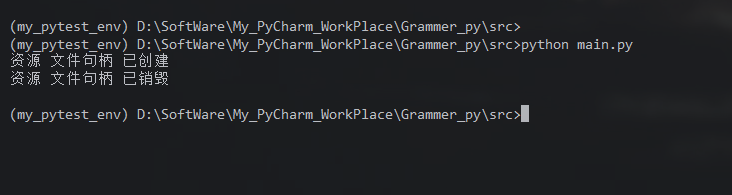

#### 5.3 调用时机的细节

-   **引用计数为 0**：在 CPython 中，当对象的引用计数降为 0 时，立即调用 `__del__`。
-   **循环引用**：如果对象之间存在循环引用，引用计数不会降为 0，需要垃圾回收器（GC）介入，`__del__` 调用时间不确定。
-   **程序退出**：解释器关闭时，剩余对象可能被回收，但顺序不确定，且某些模块可能已被销毁，`__del__` 中访问全局变量可能失败。
-   **`del` 语句**：`del x` 删除的是变量名对对象的引用，而不是对象本身。只有当引用计数为 0 时，对象才会被销毁。

#### 5.4 循环引用问题

```python
class Node:
    def __init__(self, name):
        self.name = name
        self.ref = None

    def __del__(self):
        print(f"Node {self.name} 被销毁")

a = Node("A")
b = Node("B")
a.ref = b
b.ref = a
del a
del b
# 此时两个对象互相引用，引用计数不为 0，__del__ 可能不会立即调用
# GC 最终会处理，但时机不确定
```

**建议**：避免在 `__del__` 中创建新的循环引用，或使用 `weakref` 打破循环。

#### 5.5 `__del__` 中不要抛出异常

```python
class Bad:
    def __del__(self):
        raise Exception("析构异常")

b = Bad()
del b   # 异常被忽略，打印到 stderr
```

#### 5.6 `__del__` 与上下文管理器

由于 `__del__` 的不确定性，**不应依赖它释放关键资源**。推荐使用上下文管理器（`with` 语句）或显式 `close()` 方法。

```python
class FileHandler:
    def __init__(self, filename, mode):
        self.file = open(filename, mode)

    def __enter__(self):
        return self.file

    def __exit__(self, exc_type, exc_val, exc_tb):
        self.file.close()

with FileHandler("test.txt", "w") as f:
    f.write("Hello")
# 离开 with 块时，__exit__ 一定被调用
```

**对比**：

| 机制           | 调用时机         | 确定性 | 适用场景       |
| :------------- | :--------------- | :----- | :------------- |
| `__del__`      | 垃圾回收时       | 不确定 | 兜底清理、日志 |
| `__exit__`     | 离开 `with` 块时 | 确定   | 资源管理       |
| 显式 `close()` | 手动调用         | 确定   | 资源管理       |

#### 5.7 `__del__` 的正确使用场景

`__del__` 适合用于**调试、日志记录**或**最后的兜底清理**。

```python
class Connection:
    def __init__(self, host):
        self.host = host
        self.connected = True

    def close(self):
        if self.connected:
            self.connected = False
            print(f"断开与 {self.host} 的连接")

    def __del__(self):
        if self.connected:
            print(f"警告：连接 {self.host} 未显式关闭！")
            self.close()
```

### (6) 对象销毁与垃圾回收

#### 6.1 引用计数

Python 使用引用计数作为主要的内存管理机制。每个对象维护一个引用计数，当计数为 0 时，对象被立即回收。

-   增加引用：赋值、作为参数传递、放入容器等。
-   减少引用：`del`、变量重新赋值、离开作用域等。

#### 6.2 垃圾回收器（GC）

引用计数无法处理循环引用。Python 的 `gc` 模块提供了分代垃圾回收器，定期检测并回收循环引用。

```python
import gc

gc.collect()   # 手动触发垃圾回收
```

#### 6.3 `del` 语句

`del x` 删除变量名 `x` 对对象的引用，而不是删除对象本身。如果对象还有其他引用，不会被销毁。

```python
a = [1, 2, 3]
b = a
del a          # 删除 a 的引用，列表仍被 b 引用
print(b)       # [1, 2, 3]
```

#### 6.4 弱引用

`weakref` 模块允许创建不增加引用计数的引用，常用于缓存和避免循环引用。

```python
import weakref

class Demo:
    pass

d = Demo()
r = weakref.ref(d)
print(r())   # <__main__.Demo object at ...>
del d
print(r())   # None（对象已被回收）
```

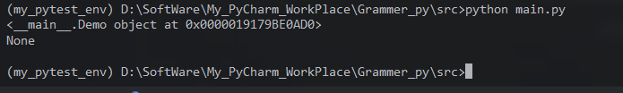

### (7) 综合示例：完整的生命周期

```python
class Lifecycle:
    def __new__(cls, *args, **kwargs):
        print("1. __new__ 被调用")
        instance = super().__new__(cls)
        return instance

    def __init__(self, value):
        print("2. __init__ 被调用")
        self.value = value

    def __del__(self):
        print("3. __del__ 被调用")

obj = Lifecycle(42)
print(f"obj.value = {obj.value}")
del obj
```

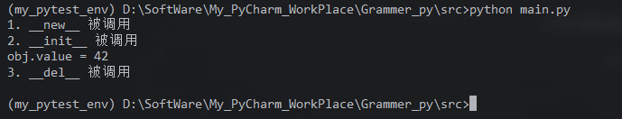

### (8) 最佳实践与陷阱

#### 8.1 `__new__`

-   大多数情况下不需要重写。
-   重写时，必须调用 `super().__new__(cls)` 创建实例。
-   如果返回的不是 `cls` 的实例，`__init__` 不会被调用。
-   用于单例、不可变类型子类、对象池等场景。

#### 8.2 `__init__`

-   必须返回 `None`。
-   子类重写时，使用 `super().__init__(...)` 调用父类初始化。
-   避免使用可变对象作为默认参数。
-   保持简洁，复杂初始化可拆分为工厂方法。

#### 8.3 `__del__`

-   不要依赖 `__del__` 释放关键资源，使用 `with` 或显式 `close()`。
-   保持 `__del__` 简单，避免抛出异常。
-   注意循环引用，必要时使用 `weakref`。
-   不要在 `__del__` 中创建新的引用，以免阻止对象回收。

### (9) 总结

| 方法       | 职责       | 调用时机         | 返回值   | 关键点                      |
| :--------- | :--------- | :--------------- | :------- | :-------------------------- |
| `__new__`  | 创建实例   | 实例化时最先调用 | 实例对象 | 静态方法，第一个参数 `cls`  |
| `__init__` | 初始化实例 | `__new__` 后调用 | `None`   | 实例方法，第一个参数 `self` |
| `__del__`  | 销毁清理   | 垃圾回收时调用   | 无       | 调用时机不确定，异常被忽略  |

**对象生命周期**：

```text
类调用 -> type.__call__ -> __new__ -> __init__ -> 使用对象 -> 引用计数为0/GC -> __del__
```


## 三、 字符串表示（**str** / **repr**）

在 Python 中，对象的字符串表示由两个特殊方法控制：

-   `__str__`：返回**用户友好**的字符串，用于 `print()`、`str()`、`f"{obj}"` 等场景。
-   `__repr__`：返回**开发者友好**的字符串，用于 `repr()`、交互式环境、容器显示、调试等场景。

### (1) `str()` 与 `repr()` 的区别

| 对比项   | `str()` / `__str__`                           | `repr()` / `__repr__`                        |
| :------- | :-------------------------------------------- | :------------------------------------------- |
| 目的     | 用户可读，友好                                | 开发者可读，明确无歧义                       |
| 调用场景 | `print()`、`str()`、`f"{obj}"`、`format(obj)` | `repr()`、交互式环境、容器显示、`f"{obj!r}"` |
| 返回值   | 任意字符串                                    | 理想情况下可 `eval()` 重建对象               |
| 默认行为 | 若未定义，回退到 `__repr__`                   | 若未定义，返回 `<类名 object at 0x...>`      |
| 示例     | `str('abc')` → `abc`                          | `repr('abc')` → `'abc'`                      |

**核心原则**：

-   `__repr__` 应尽可能精确、无歧义，方便调试。
-   `__str__` 应简洁、易读，面向最终用户。
-   如果只定义一个，**优先定义 `__repr__`**，因为 `str()` 会自动回退到 `__repr__`。


### (2) `__repr__`：开发者表示

#### 2.1 默认行为

如果类没有定义 `__repr__`，Python 使用 `object.__repr__`，返回类似：

```python
class A:
    pass

a = A()
print(repr(a))   # <__main__.A object at 0x7f...>
```

这个字符串包含类名和内存地址，对调试帮助有限。

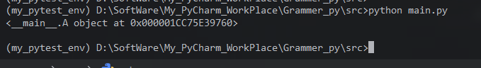

#### 2.2 自定义 `__repr__`

```python
class Point:
    def __init__(self, x, y):
        self.x = x
        self.y = y

    def __repr__(self):
        return f"Point(x={self.x!r}, y={self.y!r})"

p = Point(1, 2)
print(repr(p))   # Point(x=1, y=2)
```

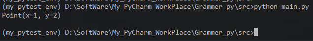

**关键点**：

-   返回值必须是 `str`，否则抛出 `TypeError`。
-   使用 `!r` 格式化属性，确保字符串属性带引号，避免歧义。
-   理想情况下，`eval(repr(obj))` 应能重建等价对象。


```python
p2 = eval(repr(p))
print(p2.x, p2.y)   # 1 2
```

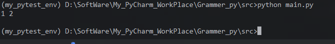

#### 2.3 在容器中的表现

当对象放入列表、字典等容器时，容器使用元素的 `__repr__` 来显示。

```python
p = Point(1, 2)
print([p])        # [Point(x=1, y=2)]
print({p: "A"})   # {Point(x=1, y=2): 'A'}
```

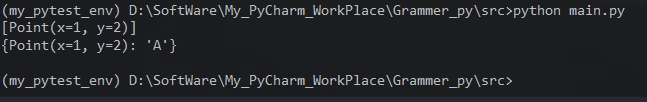

这就是为什么列表中的字符串会带引号：`print(["a"])` → `['a']`。

### (3) `__str__`：用户友好表示

#### 3.1 默认行为

如果类没有定义 `__str__`，`str()` 会回退到 `__repr__`。

```python
class Point:
    def __init__(self, x, y):
        self.x = x
        self.y = y

    def __repr__(self):
        return f"Point(x={self.x!r}, y={self.y!r})"

p = Point(1, 2)
print(str(p))   # Point(x=1, y=2)（回退到 __repr__）
```

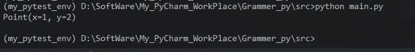

#### 3.2 自定义 `__str__`

```python
class Point:
    def __init__(self, x, y):
        self.x = x
        self.y = y

    def __repr__(self):
        return f"Point(x={self.x!r}, y={self.y!r})"

    def __str__(self):
        return f"({self.x}, {self.y})"

p = Point(1, 2)
print(str(p))    # (1, 2)
print(repr(p))   # Point(x=1, y=2)
print(p)         # (1, 2)（print 使用 str）
print([p])       # [Point(x=1, y=2)]（容器使用 repr）
```

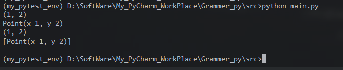

### (4) 调用时机对比

| 表达式                                  | 使用的方法                               |
| :-------------------------------------- | :--------------------------------------- |
| `str(obj)`                              | `__str__`，回退到 `__repr__`             |
| `repr(obj)`                             | `__repr__`                               |
| `print(obj)`                            | `__str__`                                |
| `f"{obj}"`                              | `__format__`，空格式规范时调用 `__str__` |
| `f"{obj!r}"`                            | `__repr__`                               |
| `f"{obj!s}"`                            | `__str__`                                |
| `format(obj, spec)`                     | `__format__`                             |
| 交互式环境直接输入 `obj`                | `__repr__`                               |
| 容器（`list`、`dict`、`tuple`）显示元素 | `__repr__`                               |
| `logging.debug("%s", obj)`              | `__str__`                                |
| `logging.debug("%r", obj)`              | `__repr__`                               |


### (5) `__format__` 与 f-string

`format()` 和 f-string 背后调用的是 `__format__` 方法。默认 `object.__format__` 在空格式规范下返回 `str(obj)`，非空规范会抛出 `TypeError`，除非自定义。

```python
class Temperature:
    def __init__(self, celsius):
        self.celsius = celsius

    def __str__(self):
        return f"{self.celsius:.1f}°C"

    def __format__(self, spec):
        if spec == "f":
            return f"{self.celsius * 9/5 + 32:.1f}°F"
        return f"{self.celsius:.1f}°C"

t = Temperature(25)
print(f"{t}")     # 25.0°C
print(f"{t:f}")   # 77.0°F
print(format(t, "f"))  # 77.0°F
```

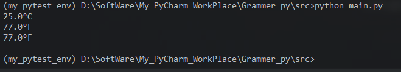

**说明**：

-   `f"{t}"` 等价于 `format(t, "")`，默认调用 `__str__`。
-   `f"{t:f}"` 调用 `__format__(t, "f")`。
-   `f"{t!r}"` 强制使用 `__repr__`。

### (6) 完整示例：`Point` 类

```python
class Point:
    def __init__(self, x, y):
        self.x = x
        self.y = y

    def __repr__(self):
        # 开发者友好：无歧义，可 eval
        return f"Point(x={self.x!r}, y={self.y!r})"

    def __str__(self):
        # 用户友好：简洁
        return f"({self.x}, {self.y})"

    def __eq__(self, other):
        return (self.x, self.y) == (other.x, other.y)

p = Point(1, 2)
print(p)            # (1, 2)
print(str(p))       # (1, 2)
print(repr(p))      # Point(x=1, y=2)
print([p])          # [Point(x=1, y=2)]
print(f"{p}")       # (1, 2)
print(f"{p!r}")     # Point(x=1, y=2)

p2 = eval(repr(p))
print(p == p2)      # True
```

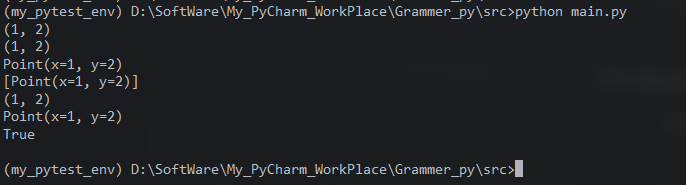

### (7) 最佳实践

#### 7.1 `__repr__`

1.  **始终定义 `__repr__`**，方便调试。
2.  返回的字符串应**无歧义**，尽可能让 `eval(repr(obj))` 能重建对象。
3.  使用 `!r` 格式化属性，例如 `f"Point(x={self.x!r}, y={self.y!r})"`。
4.  包含类名和关键属性。
5.  不要包含内存地址、时间戳等不稳定信息。
6.  避免副作用和复杂计算。

#### 7.2 `__str__`

1.  只在需要**用户友好**输出时定义。
2.  保持简洁、易读。
3.  不需要可 `eval`。
4.  如果未定义，`str()` 会自动使用 `__repr__`。

#### 7.3 不要返回非字符串

```python
class Bad:
    def __repr__(self):
        return 123   # TypeError: __repr__ returned non-string
```


#### 7.4 避免无限递归

```python
class Node:
    def __init__(self, value, next=None):
        self.value = value
        self.next = next

    def __repr__(self):
        return f"Node({self.value!r}, {self.next!r})"
```


如果 `next` 形成循环，`__repr__` 会无限递归。可以使用 `reprlib.recursive_repr` 装饰器或手动检测。

```python
from reprlib import recursive_repr

class Node:
    def __init__(self, value, next=None):
        self.value = value
        self.next = next

    @recursive_repr()
    def __repr__(self):
        return f"Node({self.value!r}, {self.next!r})"
```


#### 7.5 大对象的 `__repr__`

使用 `reprlib.repr` 截断长字符串，避免输出过长。

```python
import reprlib

class BigData:
    def __init__(self, data):
        self.data = data

    def __repr__(self):
        return f"BigData({reprlib.repr(self.data)})"
```


### (8) 标准库与工具

#### 8.1 `dataclasses`

`@dataclass` 自动生成 `__repr__`，但不生成 `__str__`。

```python
from dataclasses import dataclass

@dataclass
class Point:
    x: int
    y: int

p = Point(1, 2)
print(repr(p))   # Point(x=1, y=2)
print(str(p))    # Point(x=1, y=2)（回退到 __repr__）
```

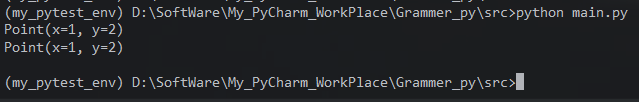

#### 8.2 `pprint`

`pprint` 模块使用 `repr` 来格式化输出，适合调试复杂数据结构。

```python
from pprint import pprint

data = {"key": [1, 2, 3], "nested": {"a": "b"}}
pprint(data)
```

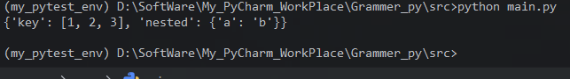

#### 8.3 `logging`

日志中使用 `%s` 调用 `str()`，使用 `%r` 调用 `repr()`。

```python
class Point:
    def __init__(self, x, y):
        self.x = x
        self.y = y

    def __repr__(self):
        # 开发者友好：无歧义，可 eval
        return f"Point(x={self.x!r}, y={self.y!r})"

    def __str__(self):
        # 用户友好：简洁
        return f"({self.x}, {self.y})"

import logging

logging.basicConfig(level=logging.DEBUG)
p = Point(1, 2)
logging.debug("Point: %s", p)   # 使用 __str__
logging.debug("Point: %r", p)   # 使用 __repr__
```

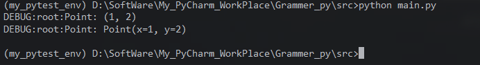

### (9) 常见陷阱

1.  **返回非字符串**：`__repr__` 和 `__str__` 必须返回 `str`。
2.  **无限递归**：循环引用时，`__repr__` 可能无限递归。
3.  **副作用**：不要在 `__repr__` 中修改对象状态或执行 I/O。
4.  **混淆 `str` 和 `repr`**：调试时用 `repr`，用户输出用 `str`。
5.  **忘记 `!r`**：在 `__repr__` 中格式化字符串属性时，不加 `!r` 会导致歧义。
6.  **依赖 `eval(repr(obj))`**：并非所有对象都能安全 eval，尤其是包含复杂状态的对象。


### (10) 总结

| 方法       | 用途       | 调用场景                   | 默认行为                 | 最佳实践                      |
| :--------- | :--------- | :------------------------- | :----------------------- | :---------------------------- |
| `__str__`  | 用户友好   | `print`、`str`、`f"{obj}"` | 回退到 `__repr__`        | 简洁易读，可选                |
| `__repr__` | 开发者友好 | `repr`、交互式、容器、调试 | `<类名 object at 0x...>` | 始终定义，无歧义，尽量可 eval |

**核心要点**：

-   `__repr__` 是调试的基石，应始终定义。
-   `__str__` 面向用户，只在需要时定义。
-   `str()` 回退到 `__repr__`，但 `repr()` 不会回退到 `__str__`。
-   容器使用元素的 `__repr__`。
-   f-string 默认使用 `__str__`，`!r` 强制使用 `__repr__`。
-   使用 `!r` 格式化属性，避免歧义。
-   注意递归和副作用。


## 四、运算符重载

运算符重载允许自定义类的对象支持 Python 内置运算符（如 `+`、`-`、`==`、`<` 等），使代码更自然、更易读。Python 通过**魔法方法**（特殊方法）实现运算符重载。

### (1) 算术运算符（**add** / **sub**等）

#### 1.1 常见算术运算符与对应方法

| 运算符     | 方法                        | 说明                |
| :--------- | :-------------------------- | :------------------ |
| `+`        | `__add__(self, other)`      | 加法                |
| `-`        | `__sub__(self, other)`      | 减法                |
| `*`        | `__mul__(self, other)`      | 乘法                |
| `/`        | `__truediv__(self, other)`  | 真除法              |
| `//`       | `__floordiv__(self, other)` | 整除                |
| `%`        | `__mod__(self, other)`      | 取模                |
| `**`       | `__pow__(self, other)`      | 幂运算              |
| `@`        | `__matmul__(self, other)`   | 矩阵乘法            |
| `divmod()` | `__divmod__(self, other)`   | 内置函数 `divmod()` |

#### 1.2 基本示例：向量加法

```python
class Vector:
    def __init__(self, x, y):
        self.x = x
        self.y = y

    def __add__(self, other):
        return Vector(self.x + other.x, self.y + other.y)

    def __sub__(self, other):
        return Vector(self.x - other.x, self.y - other.y)

    def __mul__(self, scalar):
        return Vector(self.x * scalar, self.y * scalar)

    def __repr__(self):
        return f"Vector({self.x}, {self.y})"

v1 = Vector(1, 2)
v2 = Vector(3, 4)

print(v1 + v2)   # Vector(4, 6)
print(v1 - v2)   # Vector(-2, -2)
print(v1 * 3)    # Vector(3, 6)
```

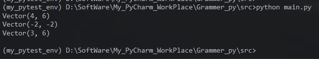

**解析**：

-   `__add__` 接收两个参数：`self` 和 `other`，返回一个新对象。
-   运算符重载不改变运算符本身的优先级和结合性。
-   返回新对象是常见做法，但也可以原地修改（不推荐，除非实现 `__iadd__`）。

#### 1.3 反向运算符

当左操作数不支持该运算时，Python 会尝试调用右操作数的**反向方法**。

| 运算符 | 反向方法                     |
| :----- | :--------------------------- |
| `+`    | `__radd__(self, other)`      |
| `-`    | `__rsub__(self, other)`      |
| `*`    | `__rmul__(self, other)`      |
| `/`    | `__rtruediv__(self, other)`  |
| `//`   | `__rfloordiv__(self, other)` |
| `%`    | `__rmod__(self, other)`      |
| `**`   | `__rpow__(self, other)`      |
| `@`    | `__rmatmul__(self, other)`   |


**示例**：标量 + 向量

```python
class Vector:
    def __init__(self, x, y):
        self.x = x
        self.y = y

    def __add__(self, other):
        if isinstance(other, Vector):
            return Vector(self.x + other.x, self.y + other.y)
        return NotImplemented

    def __radd__(self, other):
        # 支持 5 + vector
        return Vector(self.x + other, self.y + other)

    def __repr__(self):
        return f"Vector({self.x}, {self.y})"

v = Vector(1, 2)
print(v + Vector(3, 4))   # Vector(4, 6)
print(5 + v)              # Vector(6, 7) 调用 __radd__
```

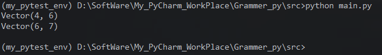

**关键点**：

-   如果 `__add__` 无法处理 `other`，应返回 `NotImplemented`（不是 `NotImplementedError`），Python 会尝试调用反向方法。
-   `__radd__` 的参数顺序：`self` 是右操作数，`other` 是左操作数。


#### 1.4 增量赋值运算符

| 运算符 | 方法                         |
| :----- | :--------------------------- |
| `+=`   | `__iadd__(self, other)`      |
| `-=`   | `__isub__(self, other)`      |
| `*=`   | `__imul__(self, other)`      |
| `/=`   | `__itruediv__(self, other)`  |
| `//=`  | `__ifloordiv__(self, other)` |
| `%=`   | `__imod__(self, other)`      |
| `**=`  | `__ipow__(self, other)`      |
| `@=`   | `__imatmul__(self, other)`   |

**示例**：

```python
class Counter:
    def __init__(self, value=0):
        self.value = value

    def __iadd__(self, other):
        self.value += other
        return self   # 必须返回 self

    def __repr__(self):
        return f"Counter({self.value})"

c = Counter(10)
c += 5
print(c)   # Counter(15)
```

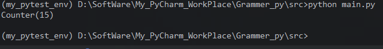

**注意**：

-   `__iadd__` 应返回 `self`，否则 `c += 5` 会将 `c` 绑定到返回值。
-   如果没有定义 `__iadd__`，Python 会回退到 `__add__`，此时 `c += 5` 等价于 `c = c + 5`，会创建新对象。


#### 1.5 一元运算符

| 运算符            | 方法                            |
| :---------------- | :------------------------------ |
| `-obj`            | `__neg__(self)`                 |
| `+obj`            | `__pos__(self)`                 |
| `abs(obj)`        | `__abs__(self)`                 |
| `~obj`            | `__invert__(self)`              |
| `round(obj)`      | `__round__(self, ndigits=None)` |
| `math.floor(obj)` | `__floor__(self)`               |
| `math.ceil(obj)`  | `__ceil__(self)`                |
| `math.trunc(obj)` | `__trunc__(self)`               |


```python
class Number:
    def __init__(self, value):
        self.value = value

    def __neg__(self):
        return Number(-self.value)

    def __abs__(self):
        return Number(abs(self.value))

    def __repr__(self):
        return f"Number({self.value})"

n = Number(-5)
print(-n)      # Number(5)
print(abs(n))  # Number(5)
```

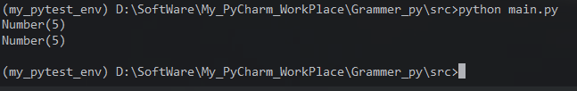

#### 1.6 类型转换相关

| 方法          | 用途                                        |
| :------------ | :------------------------------------------ |
| `__int__`     | `int(obj)`                                  |
| `__float__`   | `float(obj)`                                |
| `__complex__` | `complex(obj)`                              |
| `__bool__`    | `bool(obj)`                                 |
| `__index__`   | 用于切片、`bin()`、`hex()` 等，必须返回整数 |


```python
class Fraction:
    def __init__(self, numerator, denominator):
        self.numerator = numerator
        self.denominator = denominator

    def __float__(self):
        return self.numerator / self.denominator

    def __int__(self):
        return self.numerator // self.denominator

f = Fraction(7, 2)
print(float(f))   # 3.5
print(int(f))     # 3
```

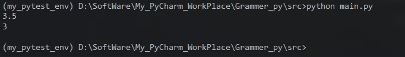

#### 1.7 注意事项

1.  **返回 `NotImplemented`**：当无法处理操作数时，返回 `NotImplemented`，让 Python 尝试其他方式。
2.  **不要修改操作数**：二元运算符通常应返回新对象，而不是修改 `self` 或 `other`。
3.  **类型检查**：使用 `isinstance` 检查 `other` 类型，但要注意鸭子类型。
4.  **反向方法**：确保对称性，例如 `a + b` 和 `b + a` 都应能工作。
5.  **增量赋值**：如果定义了 `__iadd__`，记得返回 `self`。


### (2) 比较运算符（**eq** / **lt**等）

#### 2.1 常见比较运算符与对应方法

| 运算符 | 方法                  | 说明     |
| :----- | :-------------------- | :------- |
| `==`   | `__eq__(self, other)` | 等于     |
| `!=`   | `__ne__(self, other)` | 不等于   |
| `<`    | `__lt__(self, other)` | 小于     |
| `<=`   | `__le__(self, other)` | 小于等于 |
| `>`    | `__gt__(self, other)` | 大于     |
| `>=`   | `__ge__(self, other)` | 大于等于 |


#### 2.2 基本示例：版本号比较

```python
class Version:
    def __init__(self, major, minor):
        self.major = major
        self.minor = minor

    def __eq__(self, other):
        if not isinstance(other, Version):
            return NotImplemented
        return (self.major, self.minor) == (other.major, other.minor)

    def __lt__(self, other):
        if not isinstance(other, Version):
            return NotImplemented
        return (self.major, self.minor) < (other.major, other.minor)

    def __repr__(self):
        return f"Version({self.major}, {self.minor})"

v1 = Version(1, 0)
v2 = Version(2, 0)
v3 = Version(1, 0)

print(v1 == v3)   # True
print(v1 != v2)   # True（自动取反 __eq__）
print(v1 < v2)    # True
print(v1 <= v3)   # True（若未定义 __le__，Python 不会自动推导）
```

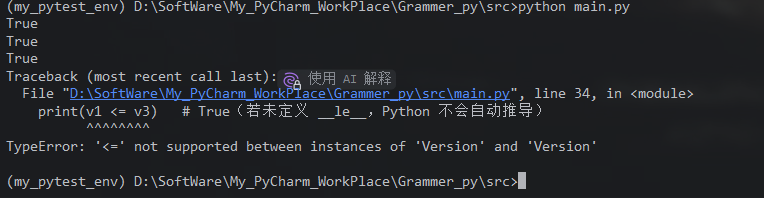

**重要**：

-   如果只定义了 `__eq__`，`!=` 会自动取反（Python 3 中 `__ne__` 默认调用 `__eq__` 并取反）。
-   但 `<`、`<=`、`>`、`>=` 之间**不会自动推导**。例如定义了 `__lt__`，`<=` 不会自动工作，除非定义 `__le__` 或使用 `functools.total_ordering`。


#### 2.3 使用 `functools.total_ordering` 简化

`@total_ordering` 装饰器可以根据 `__eq__` 和其中一个比较方法（如 `__lt__`）自动生成其他比较方法。

```python
from functools import total_ordering

@total_ordering
class Version:
    def __init__(self, major, minor):
        self.major = major
        self.minor = minor

    def __eq__(self, other):
        if not isinstance(other, Version):
            return NotImplemented
        return (self.major, self.minor) == (other.major, other.minor)

    def __lt__(self, other):
        if not isinstance(other, Version):
            return NotImplemented
        return (self.major, self.minor) < (other.major, other.minor)

    def __repr__(self):
        return f"Version({self.major}, {self.minor})"

v1 = Version(1, 0)
v2 = Version(2, 0)
v3 = Version(1, 0)

print(v1 <= v3)   # True（自动生成）
print(v1 > v2)    # False（自动生成）
print(v1 >= v3)   # True（自动生成）
```

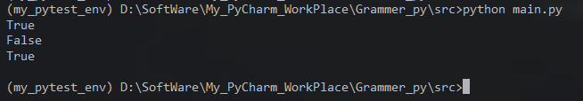

**注意**：

-   `@total_ordering` 要求至少定义 `__eq__` 和 `__lt__`（或 `__le__`、`__gt__`、`__ge__` 之一）。
-   它不会覆盖已定义的方法。

#### 2.4 `__hash__` 与可变性

当定义 `__eq__` 时，Python 会将 `__hash__` 设为 `None`，使对象不可哈希。如果对象需要作为字典键或放入集合，必须显式定义 `__hash__`。

```python
class Point:
    def __init__(self, x, y):
        self.x = x
        self.y = y

    def __eq__(self, other):
        return (self.x, self.y) == (other.x, other.y)

    def __hash__(self):
        return hash((self.x, self.y))

    def __repr__(self):
        return f"Point({self.x}, {self.y})"

p1 = Point(1, 2)
p2 = Point(1, 2)
print(p1 == p2)          # True
print(hash(p1) == hash(p2))  # True
print({p1, p2})          # {Point(1, 2)}（去重）
```

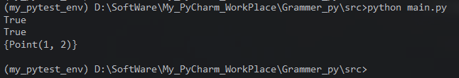

**规则**：

-   如果 `a == b`，则 `hash(a) == hash(b)` 必须成立。
-   可变对象通常不应定义 `__hash__`，或应设为 `None`，因为哈希值可能变化。
-   不可变对象适合定义 `__hash__`。

#### 2.5 比较运算符的返回值

-   比较方法应返回 `bool` 或可转换为 `bool` 的值。
-   如果无法比较，返回 `NotImplemented`。
-   不要返回 `True`/`False` 以外的值，除非有特殊需求。

### (3) 总结

#### 算术运算符重载

| 类别     | 方法                                                         | 说明                     |
| :------- | :----------------------------------------------------------- | :----------------------- |
| 二元算术 | `__add__`、`__sub__`、`__mul__`、`__truediv__`、`__floordiv__`、`__mod__`、`__pow__`、`__matmul__` | 返回新对象               |
| 反向算术 | `__radd__`、`__rsub__`、`__rmul__` 等                        | 处理左操作数不支持的情况 |
| 增量赋值 | `__iadd__`、`__isub__`、`__imul__` 等                        | 通常返回 `self`          |
| 一元运算 | `__neg__`、`__pos__`、`__abs__`、`__invert__`、`__round__` 等 |                          |
| 类型转换 | `__int__`、`__float__`、`__complex__`、`__bool__`、`__index__` |                          |

#### 比较运算符重载

| 方法       | 运算符                         |
| :--------- | :----------------------------- |
| `__eq__`   | `==`                           |
| `__ne__`   | `!=`（默认取反 `__eq__`）      |
| `__lt__`   | `<`                            |
| `__le__`   | `<=`                           |
| `__gt__`   | `>`                            |
| `__ge__`   | `>=`                           |
| `__hash__` | `hash()`，与 `__eq__` 保持一致 |

#### 最佳实践

1.  **返回 `NotImplemented`**：无法处理时返回 `NotImplemented`，让 Python 尝试其他方式。
2.  **对称性**：实现 `__add__` 时考虑 `__radd__`，保证 `a + b` 和 `b + a` 都能工作。
3.  **不修改操作数**：二元运算返回新对象。
4.  **增量赋值返回 `self`**：`__iadd__` 等应返回 `self`。
5.  **使用 `@total_ordering`**：只需定义 `__eq__` 和 `__lt__`，自动生成其他比较。
6.  **定义 `__hash__`**：如果对象需要哈希，且定义了 `__eq__`，必须定义 `__hash__`。
7.  **类型检查**：使用 `isinstance` 检查类型，但考虑鸭子类型。
8.  **文档和测试**：运算符重载应遵循数学和语言惯例，充分测试边界情况。


## 五、容器模拟（**len** / **getitem** / **setitem** / **iter**）


## 六、可调用对象（**call**）


## 七、上下文管理器（**enter** / **exit**）


## 八、with语句与上下文管理协议


## 九、描述符协议（**get** / **set** / **delete**）


## 十、类装饰器与元类初步


