# 第十二章 异常处理

## 12.1 异常的概念与分类

异常（Exception）是 Python 中处理运行时错误的核心机制。理解异常的概念、产生原因和分类体系，是编写健壮程序的基础。

### 1、异常的概念

#### 1.1 什么是异常

**异常**是程序在运行过程中发生的**非正常事件**，它会中断正常的指令流。当 Python 检测到一个它无法处理的错误时，就会**抛出（raise）**一个异常对象。

```python
print(10 / 0)
```

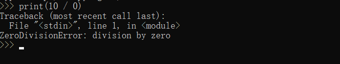

`ZeroDivisionError` 就是一个异常对象。如果没有被捕获，程序会终止，并打印**回溯信息（traceback）**。


#### 1.2 异常 vs 错误

日常交流中“错误”和“异常”常被混用，但在 Python 中有区别：

| 概念                        | 说明                                                     | 示例                 |
| :-------------------------- | :------------------------------------------------------- | :------------------- |
| **语法错误（SyntaxError）** | 代码不符合 Python 语法，**编译阶段**就被检测到，无法运行 | `if True print("x")` |
| **运行时错误（异常）**      | 语法正确，但运行过程中出现问题                           | `1/0`、`int("abc")`  |
| **逻辑错误**                | 程序能运行，但结果不符合预期                             | 算法写错，不会抛异常 |

**语法错误示例**：

```python
# 语法错误，解释器直接拒绝执行
if True
    print("hello")
```

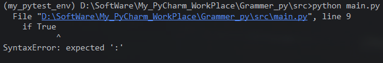

**注意**：`SyntaxError` 虽然名字带 Error，但它也是 `Exception` 的子类，只是发生在编译阶段。


#### 1.3 异常处理的意义

没有异常处理时，任何运行时错误都会导致程序崩溃：

```python
def read_config(path):
    with open(path) as f:
        return f.read()

read_config("不存在的文件.txt")   # FileNotFoundError，程序终止
```

异常处理允许我们：

1.  **捕获并恢复**：对可预期的错误做出响应，程序继续运行。
2.  **资源清理**：确保文件、连接、锁等被释放。
3.  **错误传播**：将错误转换为更有意义的异常，向上层报告。
4.  **分离错误处理与业务逻辑**：主流程保持清晰。


#### 1.4 异常的本质：对象

异常是**类的实例**。抛出异常实际上是抛出某个异常类的实例。

```python
e = ValueError("无效的值")
print(type(e))        # <class 'ValueError'>
print(e.args)         # ('无效的值',)
print(str(e))         # 无效的值
```

`raise ValueError("无效的值")` 等价于：

```python
raise ValueError("无效的值")
```

Python 会自动实例化。也可以先创建再抛出：

```python
exc = ValueError("无效的值")
raise exc
```


### 2、异常的分类

#### 2.1 异常层次结构总览

**查看完整层次**：

```python
import builtins

def print_tree(cls, indent=0):
    print("  " * indent + cls.__name__)
    for sub in sorted(cls.__subclasses__(), key=lambda c: c.__name__):
        print_tree(sub, indent + 1)

print_tree(BaseException)
```

Python 所有异常都继承自 `BaseException`。层次结构如下：	

```python
BaseException
├── SystemExit                     # sys.exit() 抛出
├── KeyboardInterrupt              # Ctrl+C 抛出
├── GeneratorExit                  # 生成器/协程关闭时抛出
└── Exception                      # 绝大多数异常的基类
    ├── ArithmeticError
    │   ├── FloatingPointError
    │   ├── OverflowError
    │   └── ZeroDivisionError
    ├── AssertionError
    ├── AttributeError
    ├── BufferError
    ├── EOFError
    ├── ImportError
    │   └── ModuleNotFoundError
    ├── LookupError
    │   ├── IndexError
    │   └── KeyError
    ├── MemoryError
    ├── NameError
    │   └── UnboundLocalError
    ├── OSError
    │   ├── BlockingIOError
    │   ├── ChildProcessError
    │   ├── ConnectionError
    │   │   ├── BrokenPipeError
    │   │   ├── ConnectionAbortedError
    │   │   ├── ConnectionRefusedError
    │   │   └── ConnectionResetError
    │   ├── FileExistsError
    │   ├── FileNotFoundError
    │   ├── InterruptedError
    │   ├── IsADirectoryError
    │   ├── NotADirectoryError
    │   ├── PermissionError
    │   ├── ProcessLookupError
    │   └── TimeoutError
    ├── ReferenceError
    ├── RuntimeError
    │   ├── NotImplementedError
    │   ├── RecursionError
    │   └── PythonFinalizationError
    ├── StopAsyncIteration
    ├── StopIteration
    ├── SyntaxError
    │   └── IndentationError
    │       └── TabError
    ├── SystemError
    ├── TypeError
    ├── ValueError
    │   └── UnicodeError
    │       ├── UnicodeDecodeError
    │       ├── UnicodeEncodeError
    │       └── UnicodeTranslateError
    └── Warning
        ├── DeprecationWarning
        ├── PendingDeprecationWarning
        ├── RuntimeWarning
        ├── SyntaxWarning
        ├── UserWarning
        ├── FutureWarning
        ├── ImportWarning
        ├── UnicodeWarning
        ├── BytesWarning
        └── ResourceWarning
```


#### 2.2 `BaseException` 的直接子类

`BaseException` 有四个直接子类，它们**不是**普通业务错误：

| 异常                | 触发场景                      | 是否应捕获                     |
| :------------------ | :---------------------------- | :----------------------------- |
| `SystemExit`        | `sys.exit()` 或 `exit()` 调用 | 通常不应捕获（除非清理后重抛） |
| `KeyboardInterrupt` | 用户按 `Ctrl+C`               | 通常不应捕获（除非清理后重抛） |
| `GeneratorExit`     | 生成器被 `close()` 或垃圾回收 | 不应捕获，用于生成器清理       |
| `Exception`         | 绝大多数普通异常              | 应捕获                         |

**关键原则**：`except Exception` 不会捕获 `SystemExit`、`KeyboardInterrupt`、`GeneratorExit`，这是**故意的设计**，避免程序无法正常退出。捕获它们需要显式写 `except BaseException` 或 `except (SystemExit, KeyboardInterrupt)`。

```python
try:
    sys.exit(0)
except Exception:
    print("这不会执行")
# 程序正常退出
```


#### 2.3 `Exception` 及其常见子类分类

`Exception` 下的异常按语义可分为几大类：

##### 2.3.1 算术与数值类

| 异常                 | 说明                 | 示例             |
| :------------------- | :------------------- | :--------------- |
| `ZeroDivisionError`  | 除数为零             | `1 / 0`          |
| `OverflowError`      | 数值超出范围         | `math.exp(1000)` |
| `FloatingPointError` | 浮点运算错误（罕见） | 需启用特定设置   |

```python
try:
    1 / 0
except ZeroDivisionError as e:
    print(f"除零错误: {e}")
```

##### 2.3.2 查找类（`LookupError`）

| 异常         | 说明         | 示例            |
| :----------- | :----------- | :-------------- |
| `IndexError` | 序列索引越界 | `[1, 2][5]`     |
| `KeyError`   | 字典键不存在 | `{}["missing"]` |

```python
try:
    [1, 2, 3][10]
except IndexError as e:
    print(f"索引越界: {e}")

try:
    {"a": 1}["b"]
except KeyError as e:
    print(f"键不存在: {e}")
```

两者共同父类 `LookupError`，可统一捕获：

```python
try:
    # 可能是索引或键访问
    pass
except LookupError as e:
    print(f"查找失败: {e}")
```

##### 2.3.4 属性与类型类

| 异常             | 说明               | 示例         |
| :--------------- | :----------------- | :----------- |
| `AttributeError` | 对象没有该属性     | `(1).append` |
| `TypeError`      | 类型不匹配         | `1 + "a"`    |
| `ValueError`     | 类型正确但值不合法 | `int("abc")` |

```python
try:
    int("abc")
except ValueError as e:
    print(f"值错误: {e}")

try:
    1 + "a"
except TypeError as e:
    print(f"类型错误: {e}")
```

**`TypeError` 与 `ValueError` 的区别**：

-   `TypeError`：**类型**不对，如 `len(123)`。
-   `ValueError`：类型对，但**值**不合法，如 `int("abc")`。

##### 2.3.5 操作系统与 I/O 类（`OSError`）

Python 3.3+ 中，`OSError` 统一了 `IOError`、`EnvironmentError` 等，并根据 `errno` 派生出细分子类。

| 异常                     | 说明                        |
| :----------------------- | :-------------------------- |
| `FileNotFoundError`      | 文件不存在                  |
| `FileExistsError`        | 文件已存在（如 `os.mkdir`） |
| `PermissionError`        | 权限不足                    |
| `IsADirectoryError`      | 期望文件但得到目录          |
| `NotADirectoryError`     | 期望目录但得到文件          |
| `TimeoutError`           | 操作超时                    |
| `ConnectionError`        | 连接相关错误                |
| `BrokenPipeError`        | 管道断裂                    |
| `ConnectionRefusedError` | 连接被拒绝                  |
| `ConnectionResetError`   | 连接被重置                  |

```python
try:
    open("不存在的文件.txt")
except FileNotFoundError as e:
    print(f"文件不存在: {e.filename}")
except PermissionError as e:
    print(f"权限不足: {e.filename}")
except OSError as e:
    print(f"其他 I/O 错误: {e.errno}, {e.strerror}")
```

**`OSError` 的常用属性**：

-   `errno`：错误码（如 `2` 表示 `ENOENT`）。
-   `strerror`：错误描述。
-   `filename`：相关文件名（部分子类）。

##### 2.3.6 导入类

| 异常                  | 说明                               |
| :-------------------- | :--------------------------------- |
| `ImportError`         | 导入失败（如名称不存在）           |
| `ModuleNotFoundError` | 模块未找到（`ImportError` 的子类） |

```python
try:
    import nonexistent_module
except ModuleNotFoundError as e:
    print(f"模块未找到: {e.name}")

try:
    from math import nonexistent_name
except ImportError as e:
    print(f"导入失败: {e}")
```

##### 2.3.7 迭代类

| 异常                 | 说明                                |
| :------------------- | :---------------------------------- |
| `StopIteration`      | 迭代器耗尽，`next()` 在无元素时抛出 |
| `StopAsyncIteration` | 异步迭代器耗尽                      |

```python
it = iter([1])
next(it)   # 1
next(it)   # StopIteration
```

`StopIteration` 在 `for` 循环中被自动处理，不应在业务代码中随意抛出。

##### 2.3.8 运行时类（`RuntimeError`）

| 异常                      | 说明                       |
| :------------------------ | :------------------------- |
| `RuntimeError`            | 其他异常的统称，如递归过深 |
| `RecursionError`          | 递归超过限制               |
| `NotImplementedError`     | 抽象方法未实现             |
| `PythonFinalizationError` | 解释器关闭期间操作不允许   |

```python
def factorial(n):
    return n * factorial(n - 1)

try:
    factorial(10000)
except RecursionError as e:
    print(f"递归过深: {e}")
```

`NotImplementedError` 常用于抽象基类：

```python
class Shape:
    def area(self):
        raise NotImplementedError("子类必须实现 area")
```

##### 2.3.9 断言类

| 异常             | 说明              |
| :--------------- | :---------------- |
| `AssertionError` | `assert` 语句失败 |

```python
try:
    assert 1 > 2, "1 不应大于 2"
except AssertionError as e:
    print(f"断言失败: {e}")
```

##### 2.3.10 语法类

| 异常               | 说明                                       |
| :----------------- | :----------------------------------------- |
| `SyntaxError`      | 语法错误（编译阶段）                       |
| `IndentationError` | 缩进错误（`SyntaxError` 子类）             |
| `TabError`         | 混用 Tab 和空格（`IndentationError` 子类） |

`SyntaxError` 的常用属性：

-   `filename`：文件名。
-   `lineno`：行号。
-   `offset`：列偏移。
-   `text`：出错代码行。

```python
try:
    compile("if True print(1)", "<string>", "exec")
except SyntaxError as e:
    print(f"语法错误: {e.msg}, 行 {e.lineno}, 列 {e.offset}")
```

##### 2.3.11 Unicode 类

| 异常                    | 说明     |
| :---------------------- | :------- |
| `UnicodeDecodeError`    | 解码失败 |
| `UnicodeEncodeError`    | 编码失败 |
| `UnicodeTranslateError` | 转换失败 |

```python
try:
    b"\xff".decode("utf-8")
except UnicodeDecodeError as e:
    print(f"解码失败: {e}")
```

#### 2.3.12 警告类（`Warning`）

`Warning` 是 `Exception` 的子类，但通常**不会中断程序**，而是通过 `warnings` 模块发出提示。

| 警告                 | 说明             |
| :------------------- | :--------------- |
| `DeprecationWarning` | 弃用警告         |
| `UserWarning`        | 用户自定义警告   |
| `RuntimeWarning`     | 运行时警告       |
| `FutureWarning`      | 未来行为变化警告 |
| `ResourceWarning`    | 资源未关闭警告   |

```python
import warnings

warnings.warn("这是一个自定义警告", UserWarning)
```

警告默认只显示一次，可通过 `warnings.filterwarnings` 控制。


#### 2.4 异常分类的维度

除了按继承层次，异常还可以按其他维度分类：

| 维度           | 类别           | 示例                                               |
| :------------- | :------------- | :------------------------------------------------- |
| **来源**       | 内置异常       | `ValueError`、`TypeError`                          |
|                | 标准库异常     | `json.JSONDecodeError`、`re.error`                 |
|                | 用户自定义异常 | `class MyError(Exception)`                         |
| **可恢复性**   | 可恢复         | `FileNotFoundError`（换路径重试）                  |
|                | 不可恢复       | `MemoryError`（通常无法恢复）                      |
| **可预期性**   | 可预期         | `ValueError`（输入校验）                           |
|                | 不可预期       | `SystemError`（解释器内部错误）                    |
| **是否应捕获** | 应捕获         | `Exception` 子类                                   |
|                | 通常不捕获     | `SystemExit`、`KeyboardInterrupt`、`GeneratorExit` |


#### 2.5 标准库中的自定义异常

标准库模块常定义自己的异常层次，方便精细捕获：

```python
import json

try:
    json.loads("{invalid}")
except json.JSONDecodeError as e:
    print(f"JSON 解析错误: {e.msg} at line {e.lineno} column {e.colno}")
```

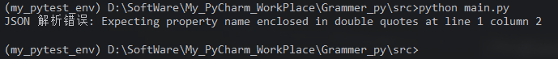

```python
import re

try:
    re.compile("[")
except re.error as e:
    print(f"正则错误: {e}")
```

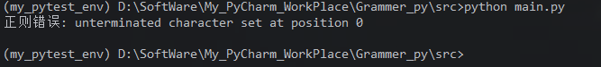

```python
import socket

try:
    socket.create_connection(("localhost", 99999), timeout=1)
except ConnectionRefusedError as e:
    print(f"连接被拒绝: {e}")
except socket.timeout as e:
    print(f"连接超时: {e}")
```

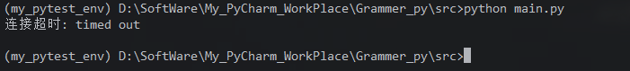

**规律**：标准库异常通常继承自 `Exception`（或相关基类），并提供额外属性（如 `JSONDecodeError.lineno`），便于定位问题。


#### 2.6 用户自定义异常的位置

自定义异常应继承 `Exception`（不要继承 `BaseException`），通常放在模块级：

```python
class AppError(Exception):
    """应用基础异常"""

class ValidationError(AppError):
    """校验错误"""

class NotFoundError(AppError):
    """资源未找到"""
```

**层次设计建议**：

-   定义一个模块级或应用级的**基类异常**，如 `AppError`。
-   所有业务异常继承该基类，便于统一捕获。
-   不要继承 `BaseException`，除非有极特殊需求。

```python
try:
    # 业务逻辑
    pass
except AppError as e:
    # 统一处理所有应用异常
    logger.error(f"应用错误: {e}")
except Exception as e:
    # 兜底处理未预期异常
    logger.exception("未预期错误")
```


### 3、异常对象的结构

#### 3.1 异常实例的常用属性

```python
try:
    open("不存在的文件.txt")
except FileNotFoundError as e:
    print(type(e))          # <class 'FileNotFoundError'>
    print(e.args)           # (2, 'No such file or directory')
    print(e.errno)          # 2
    print(e.strerror)       # No such file or directory
    print(e.filename)       # 不存在的文件.txt
    print(str(e))           # [Errno 2] No such file or directory: '不存在的文件.txt'
```


| 属性            | 说明                               |
| :-------------- | :--------------------------------- |
| `args`          | 构造异常时传入的参数元组           |
| `__cause__`     | 显式异常链（`raise ... from ...`） |
| `__context__`   | 隐式异常链（异常处理中又抛异常）   |
| `__traceback__` | 回溯对象                           |
| `__notes__`     | 附加注释（`add_note()` 添加）      |


#### 3.2 回溯信息（traceback）

异常未被捕获时，Python 打印的 `Traceback` 记录了调用栈，从最外层到出错点：

```python
Traceback (most recent call last):
  File "demo.py", line 10, in <module>
    main()
  File "demo.py", line 6, in main
    1 / 0
ZeroDivisionError: division by zero
```

**阅读顺序**：从上到下是调用链，最底部是实际出错位置和异常类型。


#### 3.3 `raise ... from ...`：显式异常链

```python
try:
    int("abc")
except ValueError as e:
    raise RuntimeError("解析配置失败") from e
```

**输出**

```python
ValueError: invalid literal for int() with base 10: 'abc'

The above exception was the direct cause of the following exception:

RuntimeError: 解析配置失败
```

`from e` 设置 `__cause__`，明确表示“由 e 导致”。


#### 3.4 `raise ... from None`：抑制异常链

```python
try:
    int("abc")
except ValueError:
    raise RuntimeError("解析失败") from None
```

**输出**：

```python
RuntimeError: 解析失败
```

原始 `ValueError` 被隐藏，只显示新异常。


### 4、异常分类的实践意义

#### 4.1 精确捕获

异常层次结构允许我们**由具体到宽泛**地捕获：

```python
try:
    data = open("config.json").read()
    config = json.loads(data)
    port = int(config["port"])
except FileNotFoundError:
    print("配置文件不存在，使用默认配置")
except json.JSONDecodeError as e:
    print(f"配置文件格式错误: {e}")
except (KeyError, ValueError) as e:
    print(f"配置项无效: {e}")
except OSError as e:
    print(f"I/O 错误: {e}")
```

>    **原则**：先捕获具体异常，再捕获宽泛异常。


#### 4.2 避免过度捕获

```python
# 不好：掩盖了所有错误
try:
    process()
except Exception:
    pass

# 好：只捕获预期错误，其他错误应暴露
try:
    process()
except (ValueError, KeyError) as e:
    logger.warning(f"输入无效: {e}")
```


### 4.3 异常类型作为 API 契约

函数的文档字符串应说明可能抛出的异常：

```python
def parse_age(text):
    """
    将字符串解析为年龄。

    Raises:
        ValueError: 文本不是有效整数，或年龄不在 0-150 范围内。
    """
    age = int(text)
    if not 0 <= age <= 150:
        raise ValueError(f"年龄超出范围: {age}")
    return age
```


### 5、总结

#### 异常的概念

| 要点                   | 说明                         |
| :--------------------- | :--------------------------- |
| 异常是运行时非正常事件 | 中断正常指令流               |
| 异常是对象             | 异常类的实例，携带信息       |
| 与语法错误的区别       | 语法错误在编译阶段被拒绝     |
| 异常处理的意义         | 恢复、清理、传播、分离关注点 |

#### 异常的分类

| 层级                                                 | 关键点                                  |
| :--------------------------------------------------- | :-------------------------------------- |
| `BaseException`                                      | 所有异常的根                            |
| `SystemExit` / `KeyboardInterrupt` / `GeneratorExit` | 系统级异常，通常不捕获                  |
| `Exception`                                          | 普通异常的基类，业务代码应捕获          |
| `LookupError`                                        | `IndexError`、`KeyError` 的父类         |
| `OSError`                                            | I/O 错误，按 `errno` 细分               |
| `ArithmeticError`                                    | `ZeroDivisionError`、`OverflowError`    |
| `RuntimeError`                                       | `RecursionError`、`NotImplementedError` |
| `SyntaxError`                                        | 编译阶段异常                            |
| `Warning`                                            | 警告，不中断程序                        |

#### 核心原则

1.  **异常是对象**，携带类型、消息、回溯等丰富信息。
2.  **`Exception` 是业务异常的基类**，不要捕获 `BaseException`。
3.  **`SystemExit`、`KeyboardInterrupt`、`GeneratorExit` 不应被 `except Exception` 捕获**。
4.  **精确捕获**：先具体后宽泛，避免 `except Exception: pass`。
5.  **自定义异常继承 `Exception`**，建立清晰的异常层次。
6.  **异常链**（`raise ... from ...`）保留原始错误上下文。
7.  **异常传播不回滚副作用**，资源清理靠 `finally` 或 `with`。


## 12.2 try-except-else-finally

`try-except-else-finally` 是 Python 异常处理的核心语法结构。它提供了**捕获异常、正常分支处理、无条件清理**的完整机制。

### 1、语法结构总览

```python
try:
    # 可能出错的代码
    risky_operation()
except SomeError as e:
    # 捕获并处理特定异常
    handle_error(e)
except (OtherError, AnotherError) as e:
    # 捕获多个异常
    handle_other(e)
else:
    # try 块没有发生异常时执行
    on_success()
finally:
    # 无论是否发生异常都会执行
    cleanup()
```

**语法规则**：

1.  `try` 块必须存在。
2.  `except` 可以有零个或多个。
3.  `else` 可选，但**必须跟在至少一个 `except` 之后**，且**不能单独与 `finally` 搭配**。
4.  `finally` 可选。
5.  `try` 块后面必须至少有一个 `except` 或 `finally`（不能只有 `try` 和 `else`）。

合法的组合：

| 组合                                  | 是否合法 |
| :------------------------------------ | :------- |
| `try` + `except`                      | ✅        |
| `try` + `finally`                     | ✅        |
| `try` + `except` + `else`             | ✅        |
| `try` + `except` + `finally`          | ✅        |
| `try` + `except` + `else` + `finally` | ✅        |
| `try` + `else`                        | ❌        |
| `try` + `else` + `finally`            | ❌        |


### 2、各部分详解

#### 2.1 `try` 块

包含**可能抛出异常**的代码。`try` 块中的代码从上到下执行，一旦某行抛出异常，**剩余代码不再执行**，控制流跳转到匹配的 `except` 或 `finally`。

```python
try:
    a = int("123")
    b = int("abc")   # 这里抛出 ValueError
    c = a + b        # 不会执行
    print("这行不会执行")
except ValueError as e:
    print(f"捕获: {e}")
```

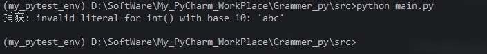

**注意**：

-   `try` 块应尽量**小**，只包裹可能出错的语句，避免掩盖无关错误。
-   不要用 `try` 包裹大量不相关逻辑，否则难以定位问题。


#### 2.2 `except` 块

用于捕获并处理异常。有多种形式。

##### 2.2.1 捕获特定异常

```python
try:
    x = 1 / 0
except ZeroDivisionError:
    print("除零错误")
```


##### 2.2.2 捕获并获取异常对象（`as`）

```python
try:
    x = int("abc")
except ValueError as e:
    print(f"异常类型: {type(e).__name__}")
    print(f"异常信息: {e}")
    print(f"异常参数: {e.args}")
```

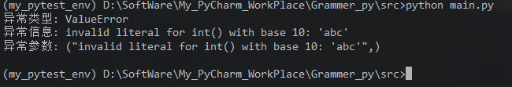

**重要细节**：`as e` 中的 `e` 在 `except` 块结束时会被**自动删除**（Python 3 行为），防止循环引用。

```python
try:
    x = int("abc")
except ValueError as e:
    pass
# print(e)   # NameError: name 'e' is not defined
```

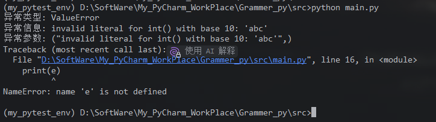


如需在 `except` 外使用，应提前赋值给其他变量：

```python
error = None
try:
    x = int("abc")
except ValueError as e:
    error = e
print(error)   # invalid literal for int() with base 10: 'abc'
```

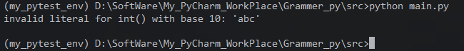


##### 2.2.3 捕获多个异常（元组）

```python
try:
    data = {"a": 1}
    value = data["b"]
except (KeyError, IndexError, ValueError) as e:
    print(f"数据访问失败: {e}")
```

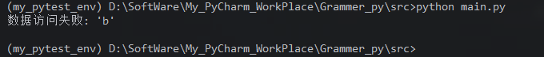


##### 2.2.4 多个 `except` 分支

```python
try:
    x = int("abc")
except ValueError as e:
    print(f"值错误: {e}")
except TypeError as e:
    print(f"类型错误: {e}")
except Exception as e:
    print(f"其他错误: {e}")
```

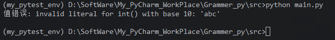


##### 2.2.5 匹配顺序：从上到下，第一个匹配的执行

`except` 按**书写顺序**匹配，第一个匹配的 `except` 执行，后续不再检查。

```python
try:
    x = int("abc")
except Exception as e:
    print("宽泛捕获先执行")
except ValueError as e:
    print("永远不会执行")
```

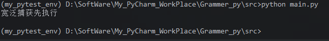

>    **原则**：**具体异常在前，宽泛异常在后**。


```python
try:
    x = int("abc")
except ValueError as e:
    print(f"值错误: {e}")       # 匹配
except Exception as e:
    print(f"其他错误: {e}")     # 不执行
```

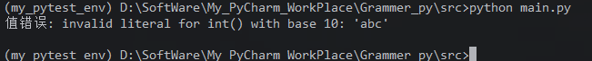


##### 2.2.6 裸 `except`（不推荐）

```python
try:
    risky()
except:   # 等价于 except BaseException
    pass
```

**问题**：

-   捕获所有异常，包括 `SystemExit`、`KeyboardInterrupt`、`GeneratorExit`。
-   导致 `Ctrl+C` 无法中断程序。
-   掩盖真正的错误，难以调试。

**替代**：

```python
try:
    risky()
except Exception as e:   # 只捕获普通异常
    handle(e)
```

只有在**极少数场景**（如日志记录后重新抛出）才考虑裸 `except`：

```python
try:
    risky()
except BaseException:
    logger.exception("发生异常")
    raise   # 重新抛出
```


##### 2.2.7 异常匹配基于继承

`except` 匹配的是**异常类及其子类**：


```python
try:
    open("不存在的文件.txt")
except OSError as e:
    print(f"OSError 捕获: {type(e).__name__}")
```

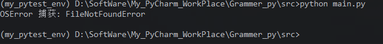

**输出**：`OSError 捕获: FileNotFoundError`

`FileNotFoundError` 是 `OSError` 的子类，被父类 `OSError` 捕获。


##### 2.2.8 在 `except` 中重新抛出

```python
try:
    process()
except ValueError as e:
    logger.warning(f"输入无效: {e}")
    raise   # 原样重新抛出
```

`raise` 不带参数时，重新抛出**当前正在处理的异常**，保留原始回溯信息。

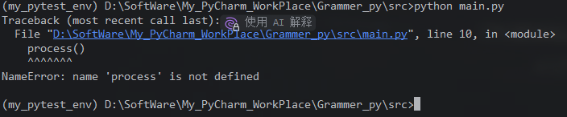


#### 2.3 `else` 块

`else` 块在 **`try` 块没有发生异常**时执行，**在 `finally` 之前**。

```python
try:
    result = risky_operation()
except Exception as e:
    print(f"失败: {e}")
else:
    print(f"成功: {result}")
```

##### 2.3.1 `else` 的意义

**核心作用**：将“成功后的处理”与“可能出错的代码”分离，避免误捕获 `else` 中的异常。

对比：

```python
# 不用 else：else 逻辑放在 try 中，其异常也会被 except 捕获
try:
    result = risky_operation()
    process_result(result)   # 这里出错也会被 except 捕获，可能不是预期
except Exception as e:
    print(f"失败: {e}")

# 用 else：只有 risky_operation 的异常被捕获
try:
    result = risky_operation()
except Exception as e:
    print(f"失败: {e}")
else:
    process_result(result)   # 这里的异常不会被上面的 except 捕获
```


##### 2.3.2 `else` 与 `return` 的交互

`else` 中的 `return` 与 `try` 中的 `return` 行为一致，`finally` 仍会执行。

```python
def f():
    try:
        return "try"
    except Exception:
        return "except"
    else:
        return "else"   # try 正常结束后执行，覆盖 try 的 return

print(f())   # else
```

**执行顺序**：

1.  `try` 中的 `return "try"` 准备返回，但被延迟。
2.  因为没有异常，执行 `else`，`return "else"` 覆盖之前的返回值。
3.  `finally` 执行（如果有）。
4.  最终返回 `"else"`。


#### 2.4 `finally` 块

`finally` 块**无论是否发生异常都会执行**，用于资源清理、关闭连接、释放锁等。

```python
f = None
try:
    f = open("data.txt")
    data = f.read()
except FileNotFoundError:
    print("文件不存在")
finally:
    if f:
        f.close()
    print("清理完成")
```

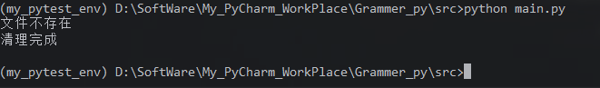


##### 2.4.1 `finally` 的保证

`finally` 在以下情况下都会执行：

-   `try` 正常结束。
-   `try` 中抛出异常，被 `except` 捕获。
-   `try` 中抛出异常，未被 `except` 捕获（异常在 `finally` 执行后继续传播）。
-   `try`/`except`/`else` 中有 `return`、`break`、`continue`。
-   `try` 中调用 `sys.exit()`。

```python
def f():
    try:
        return 1
    finally:
        print("finally 执行")

print(f())
# 输出：
# finally 执行
# 1
```

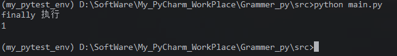


##### 2.4.2 `finally` 中不要 `return`

`finally` 中的 `return` 会**覆盖** `try`/`except`/`else` 中的返回值，甚至**吞掉异常**。

```python
def bad():
    try:
        raise ValueError("出错了")
    finally:
        return "finally"   # 吞掉异常，返回 "finally"

print(bad())   # finally（异常被吞）
```

**这通常不是期望的行为**，应避免在 `finally` 中 `return`。

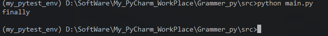


##### 2.4.3 `finally` 中的异常

如果 `finally` 中抛出异常，会**替换**原始异常（如果有）：

```python
try:
    try:
        raise ValueError("原始错误")
    finally:
        raise RuntimeError("finally 中的错误")
except RuntimeError as e:
    print(f"捕获: {e}")   # 捕获: finally 中的错误
```

原始 `ValueError` 会保存在 `RuntimeError.__context__` 中：

```python
try:
    try:
        raise ValueError("原始错误")
    finally:
        raise RuntimeError("finally 中的错误")
except RuntimeError as e:
    print(e.__context__)   # 原始错误
```


##### 2.4.4 `finally` 与 `break`/`continue`

`break`/`continue` 在 `try` 中触发时，`finally` 仍会执行。

```python
for i in range(3):
    try:
        if i == 1:
            continue
        print(f"处理 {i}")
    finally:
        print(f"清理 {i}")
```

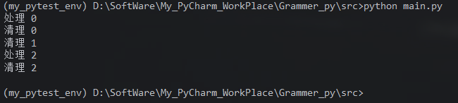


##### 2.4.5 `try/finally` 的等价 `with`

```python
# try/finally
f = open("data.txt")
try:
    data = f.read()
finally:
    f.close()

# 等价 with
with open("data.txt") as f:
    data = f.read()
```

`with` 更简洁，推荐用于资源管理。

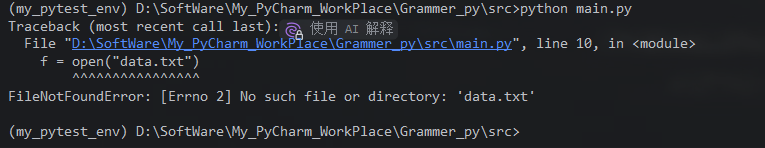


### 3、完整执行流程

#### 3.1 正常执行（无异常）

```python
try:
    print("try")
except Exception:
    print("except")
else:
    print("else")
finally:
    print("finally")
```

**输出**：

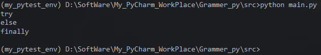

**流程**：`try` → `else` → `finally`


#### 3.2 发生异常并被捕获

```python
try:
    print("try")
    raise ValueError("出错了")
except ValueError:
    print("except")
else:
    print("else")
finally:
    print("finally")
```

**流程**：`try`（部分）→ `except` → `finally`。`else` 不执行。

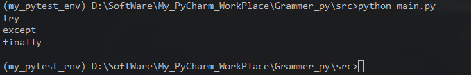


#### 3.3 发生异常但未被捕获


```python
try:
    print("try")
    raise ValueError("出错了")
except TypeError:
    print("except TypeError")
else:
    print("else")
finally:
    print("finally")
```

**流程**：`try`（部分）→ `finally` → 异常传播。`except` 不匹配，`else` 不执行。

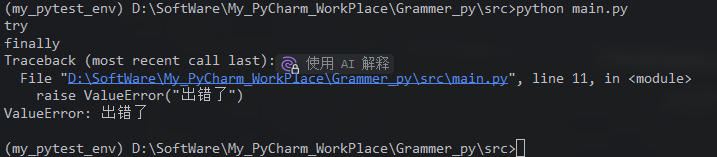


#### 3.4 异常匹配流程图

```text
           ┌─────────────┐
           │  执行 try   │
           └──────┬──────┘
                  │
        ┌─────────┴─────────┐
        │                   │
     无异常              有异常
        │                   │
        ▼                   ▼
   ┌─────────┐       ┌──────────────┐
   │ 执行 else│       │ 匹配 except?  │
   └────┬────┘       └──────┬───────┘
        │                   │
        │          ┌────────┴────────┐
        │          │                 │
        │        匹配              不匹配
        │          │                 │
        │          ▼                 │
        │    ┌──────────┐            │
        │    │ 执行 except│            │
        │    └────┬─────┘            │
        │         │                  │
        └─────────┴──────────────────┘
                  │
                  ▼
           ┌─────────────┐
           │ 执行 finally │
           └──────┬──────┘
                  │
                  ▼
         返回 / 继续 / 传播异常
```


### 4、`return` 与 `finally` 的交互

这是异常处理中最容易出错的部分。

#### 4.1 `try` 中 `return`，`finally` 执行

```python
def f():
    try:
        return "try"
    finally:
        print("finally 执行")

print(f())
# 输出：
# finally 执行
# try
```

**流程**：`return` 准备返回值 → 暂停返回 → 执行 `finally` → 真正返回。

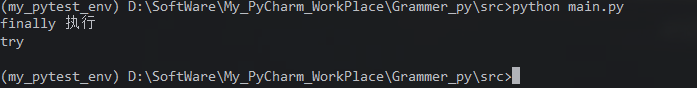


#### 4.2 `finally` 中 `return` 覆盖 `try` 的返回值

```python
def f():
    try:
        return "try"
    finally:
        return "finally"

print(f())   # finally
```

**原因**：`finally` 中的 `return` 会覆盖之前准备返回的值。

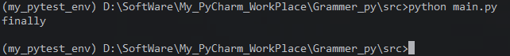


#### 4.3 `finally` 修改可变对象会影响返回值

```python
def f():
    result = []
    try:
        return result
    finally:
        result.append("modified")

print(f())   # ['modified']
```

**原因**：`return` 保存的是对象引用，`finally` 修改对象内容会影响返回值。

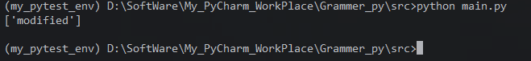

但重新赋值不可变对象不影响：

```python
def f():
    x = 1
    try:
        return x
    finally:
        x = 2   # 不影响返回值

print(f())   # 1
```

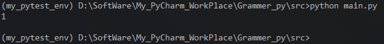


#### 4.4 `finally` 中 `break`/`continue` 的影响

```python
def f():
    for i in range(3):
        try:
            if i == 1:
                return i
        finally:
            continue   # 覆盖 return，继续循环

print(f())   # None（循环结束，无返回值）
```

`finally` 中的 `continue` 会**丢弃** `try` 中的 `return`，继续循环。


#### 4.5 总结表

| 场景                                     | 最终行为                                      |
| :--------------------------------------- | :-------------------------------------------- |
| `try` 中 `return`，`finally` 无 `return` | 返回 `try` 的值                               |
| `try` 中 `return`，`finally` 中 `return` | 返回 `finally` 的值                           |
| `try` 中 `raise`，`finally` 中 `return`  | 异常被吞，返回 `finally` 的值                 |
| `try` 中 `raise`，`finally` 中 `raise`   | 抛出 `finally` 的异常，原异常在 `__context__` |
| `finally` 修改可变对象                   | 影响返回值                                    |
| `finally` 重新赋值不可变对象             | 不影响返回值                                  |


### 5、嵌套 `try`

```python
try:
    try:
        risky()
    except ValueError:
        print("内层处理 ValueError")
    finally:
        print("内层 finally")
except Exception as e:
    print(f"外层处理: {e}")
finally:
    print("外层 finally")
```

**执行顺序**：内层 `try` → 内层 `except` → 内层 `finally` → 外层 `finally`。

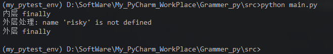

**注意**：内层未捕获的异常会传播到外层。

```python
def process():
    try:
        try:
            raise ValueError("内层错误")
        finally:
            print("内层清理")
    except ValueError as e:
        print(f"外层捕获: {e}")
    finally:
        print("外层清理")

process()
# 输出：
# 内层清理
# 外层捕获: 内层错误
# 外层清理
```

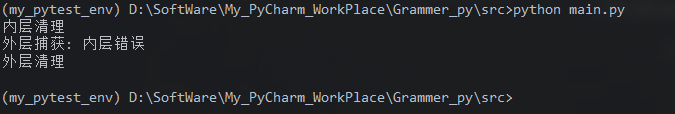


### 6、常见陷阱

#### 6.1 裸 `except` 捕获一切

```python
# 危险：吞掉 KeyboardInterrupt、SystemExit
try:
    long_running_task()
except:
    pass
```

>    **修复**：使用 `except Exception` 或具体异常。

#### 6.2 `except` 顺序错误

```python
# 错误：宽泛异常在前，具体异常永远不执行
try:
    int("abc")
except Exception as e:
    print("宽泛")
except ValueError as e:
    print("具体")   # 永远不执行
```

>   **修复**：具体在前，宽泛在后。

#### 6.3 `finally` 中 `return` 吞异常

```python
def dangerous():
    try:
        raise ValueError("错误")
    finally:
        return "ok"   # 异常被吞

print(dangerous())   # ok
```

>   **修复**：`finally` 中不要 `return`/`break`/`continue`。

#### 6.4 `except` 中忘记重新抛出

```python
try:
    critical_operation()
except Exception as e:
    logger.error(f"失败: {e}")
    # 忘记 raise，调用者以为成功了
```

>   **修复**：如需上层感知失败，应 `raise` 或返回错误标识。

#### 6.5 `try` 块过大

```python
try:
    data = load_data()
    validate(data)
    result = process(data)
    save(result)
    send_email(result)
except Exception:
    print("出错了")   # 无法知道哪一步出错
```

>   **修复**：缩小 `try` 范围，分别处理不同阶段。

#### 6.6 `as e` 变量在 `except` 外不可用

```python
try:
    int("abc")
except ValueError as e:
    error = e
# print(e)   # NameError
print(error)   # 正确
```

#### 6.7 `finally` 中抛出异常替换原异常

```python
try:
    raise ValueError("原始")
finally:
    raise RuntimeError("finally 错误")   # 原始异常被替换
```

>   **修复**：`finally` 中的代码应简单、安全，避免抛异常。

#### 6.8 忘记 `else` 导致误捕获

```python
try:
    result = load_config()       # 可能 FileNotFoundError
    process(result)              # 这里的 ValueError 也会被下面的 except 捕获
except FileNotFoundError:
    result = default_config()
```

>   **修复**：使用 `else` 分离：

```python
try:
    result = load_config()
except FileNotFoundError:
    result = default_config()
else:
    process(result)   # 这里的异常不会被上面的 except 捕获
```


### 7、最佳实践

#### 7.1 精确捕获

```python
try:
    value = int(user_input)
except ValueError:
    value = 0
```

不要 `except Exception: pass`。


#### 7.2 `try` 块尽量小

```python
# 好
try:
    value = int(text)
except ValueError:
    value = 0

# 不好
try:
    text = read_file()
    value = int(text)
    save(value)
except ValueError:
    value = 0
```


#### 7.3 资源清理用 `with` 或 `finally`

```python
with open("data.txt") as f:
    data = f.read()

# 或
f = open("data.txt")
try:
    data = f.read()
finally:
    f.close()
```


#### 7.4 `else` 用于成功分支

```python
try:
    result = risky()
except SpecificError as e:
    handle(e)
else:
    process(result)   # 只有成功才执行
```


#### 7.5 保留异常上下文

```python
try:
    config = json.loads(text)
except json.JSONDecodeError as e:
    raise ConfigError("配置格式错误") from e
```


#### 7.6 记录日志后重新抛出

```python
try:
    process()
except Exception:
    logger.exception("处理失败")
    raise
```


#### 7.7 不要用异常控制正常流程

```python
# 不好：用异常判断键是否存在
try:
    value = data[key]
except KeyError:
    value = default

# 好：用 dict.get
value = data.get(key, default)
```

异常应用于**异常情况**，不应替代正常控制流。


#### 7.8 自定义异常层次

```python
class AppError(Exception):
    """应用基础异常"""

class ValidationError(AppError):
    pass

class NotFoundError(AppError):
    pass

try:
    process()
except AppError as e:
    logger.error(f"应用错误: {e}")
except Exception:
    logger.exception("未预期错误")
    raise
```


### 8、综合示例

#### 8.1 配置文件加载

```python
import json
import logging

logger = logging.getLogger(__name__)

def load_config(path):
    """
    加载 JSON 配置文件。

    Raises:
        ConfigError: 文件不存在、格式错误或缺少必要字段。
    """
    try:
        with open(path, encoding="utf-8") as f:
            text = f.read()
    except FileNotFoundError as e:
        raise ConfigError(f"配置文件不存在: {path}") from e
    except PermissionError as e:
        raise ConfigError(f"无权限读取: {path}") from e
    except OSError as e:
        raise ConfigError(f"读取失败: {e}") from e

    try:
        config = json.loads(text)
    except json.JSONDecodeError as e:
        raise ConfigError(f"JSON 格式错误: 行 {e.lineno}, 列 {e.colno}: {e.msg}") from e

    if "port" not in config:
        raise ConfigError("缺少必要字段: port")

    return config


def main():
    try:
        config = load_config("config.json")
    except ConfigError as e:
        logger.error(f"配置加载失败: {e}")
        config = {"port": 8080}
    else:
        logger.info(f"配置加载成功: port={config['port']}")
    finally:
        logger.info("配置初始化完成")

    return config
```


#### 8.2 数据库事务

```python
def transfer(from_account, to_account, amount):
    conn = None
    try:
        conn = connect()
        conn.begin()

        from_balance = conn.query("SELECT balance FROM accounts WHERE id = ?", from_account)
        if from_balance < amount:
            raise InsufficientFunds(f"余额不足: {from_balance} < {amount}")

        conn.execute("UPDATE accounts SET balance = balance - ? WHERE id = ?", amount, from_account)
        conn.execute("UPDATE accounts SET balance = balance + ? WHERE id = ?", amount, to_account)

        conn.commit()
    except InsufficientFunds:
        if conn:
            conn.rollback()
        raise
    except DatabaseError as e:
        if conn:
            conn.rollback()
        raise TransferError("转账失败") from e
    else:
        logger.info(f"转账成功: {from_account} -> {to_account}: {amount}")
    finally:
        if conn:
            conn.close()
```


#### 8.3 重试机制

```python
import time

def retry(func, max_attempts=3, delay=1.0, exceptions=(Exception,)):
    last_exc = None
    for attempt in range(1, max_attempts + 1):
        try:
            return func()
        except exceptions as e:
            last_exc = e
            if attempt < max_attempts:
                print(f"第 {attempt} 次失败: {e}，{delay}s 后重试")
                time.sleep(delay)
    raise last_exc


def flaky_operation():
    import random
    if random.random() < 0.7:
        raise ConnectionError("网络抖动")
    return "成功"

try:
    result = retry(flaky_operation, max_attempts=5, delay=0.1, exceptions=(ConnectionError,))
    print(result)
except ConnectionError as e:
    print(f"重试全部失败: {e}")
```


### 9、总结

#### 各部分职责

| 部分      | 执行时机             | 作用                     |
| :-------- | :------------------- | :----------------------- |
| `try`     | 总是                 | 包裹可能出错的代码       |
| `except`  | `try` 抛出匹配异常时 | 捕获并处理异常           |
| `else`    | `try` 正常结束时     | 执行成功分支，避免误捕获 |
| `finally` | 总是（无论异常与否） | 资源清理，保证执行       |

#### 执行顺序

| 场景       | 执行顺序                            |
| :--------- | :---------------------------------- |
| 无异常     | `try` → `else` → `finally`          |
| 异常被捕获 | `try`（部分）→ `except` → `finally` |
| 异常未捕获 | `try`（部分）→ `finally` → 异常传播 |

#### 核心原则

1.  **`try` 块尽量小**，只包裹可能出错的语句。
2.  **精确捕获**，具体异常在前，宽泛在后。
3.  **避免裸 `except`**，使用 `except Exception`。
4.  **`else` 分离成功分支**，避免误捕获。
5.  **`finally` 中不要 `return`/`break`/`continue`**，避免吞异常。
6.  **资源清理优先 `with`**，`finally` 作为补充。
7.  **保留异常上下文**，使用 `raise ... from ...`。
8.  **记录日志后重新抛出**，不要静默吞掉。
9.  **不要用异常控制正常流程**。
10.  **`as e` 变量在 `except` 外不可用**，需提前保存。


## 12.3 捕获多个异常

在实际开发中，一段代码可能抛出多种异常，且处理方式相同或相关。Python 提供了多种方式捕获多个异常，包括**元组形式**、**多个 `except` 分支**，以及 Python 3.11+ 的**异常组**。

### 1、捕获多个异常的三种方式

| 方式               | 语法                          | 适用场景             |
| :----------------- | :---------------------------- | :------------------- |
| 元组形式           | `except (A, B, C) as e:`      | 多种异常处理逻辑相同 |
| 多个 `except` 分支 | `except A: ... except B: ...` | 每种异常处理逻辑不同 |
| 异常组（3.11+）    | `except* A:`                  | 同时处理多个独立异常 |


### 2、元组形式：`except (A, B) as e`

#### 2.1 基本语法

```python
try:
    risky_operation()
except (ValueError, TypeError, KeyError) as e:
    print(f"捕获到异常: {type(e).__name__}: {e}")
```

-   括号内是**异常类元组**，任意一个匹配即捕获。
-   `as e` 绑定的是**实际抛出的异常实例**，类型是元组中某个具体类，而非元组本身。


#### 2.2 示例：解析数据

```python
def parse_record(record):
    try:
        name = record["name"]
        age = int(record["age"])
        return {"name": name, "age": age}
    except (KeyError, ValueError, TypeError) as e:
        print(f"数据无效: {type(e).__name__}: {e}")
        return None

# KeyError
parse_record({})
# 数据无效: KeyError: 'name'

# ValueError
parse_record({"name": "Alice", "age": "abc"})
# 数据无效: ValueError: invalid literal for int() with base 10: 'abc'

# TypeError
parse_record({"name": "Alice", "age": None})
# 数据无效: TypeError: int() argument must be a string...
```

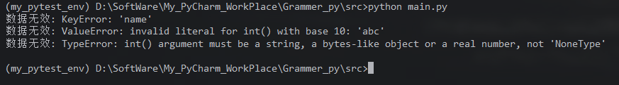

#### 2.3 区分具体异常类型

元组捕获后，`e` 是实际异常实例。可以通过 `type(e)` 或 `isinstance(e, ...)` 区分：

```python
try:
    risky()
except (ValueError, TypeError) as e:
    if isinstance(e, ValueError):
        print(f"值错误: {e}")
    elif isinstance(e, TypeError):
        print(f"类型错误: {e}")
```

**注意**：如果需要区分处理，通常**直接用多个 `except` 分支**更清晰。元组形式适合“处理逻辑一致”的场景。


#### 2.4 元组中不能包含非异常类

```python
try:
    pass
except (ValueError, "not a class") as e:   # TypeError
    pass
```

`except` 后的元组元素必须是 `BaseException` 的子类，否则在**运行时**抛出 `TypeError`。


#### 2.5 元组中异常的继承关系

如果元组中包含有继承关系的异常，捕获时按**实际类型**绑定，但不会重复捕获。

```python
try:
    open("不存在.txt")
except (OSError, FileNotFoundError) as e:
    print(type(e).__name__)   # FileNotFoundError
```

`FileNotFoundError` 是 `OSError` 的子类，`e` 的实际类型是 `FileNotFoundError`。元组中出现冗余的父子类不会报错，但通常没必要。


### 3、多个 `except` 分支

#### 3.1 基本语法

```python
try:
    risky()
except ValueError as e:
    handle_value_error(e)
except TypeError as e:
    handle_type_error(e)
except (KeyError, IndexError) as e:
    handle_lookup_error(e)
except Exception as e:
    handle_other(e)
```


#### 3.2 匹配规则：从上到下，第一个匹配的执行

```python
try:
    int("abc")
except ValueError as e:
    print(f"分支1: {e}")      # 匹配，执行
except Exception as e:
    print(f"分支2: {e}")      # 不执行
```

**输出**：`分支1: invalid literal for int() with base 10: 'abc'`

一旦某个 `except` 匹配，**后续分支不再检查**。

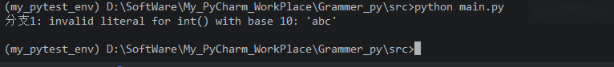

#### 3.3 匹配基于继承：子类会被父类的 `except` 捕获

```python
try:
    open("不存在.txt")
except OSError as e:
    print(f"OSError 捕获: {type(e).__name__}")
```

**输出**：`OSError 捕获: FileNotFoundError`

因为 `FileNotFoundError` 继承自 `OSError`，`except OSError` 能捕获它。

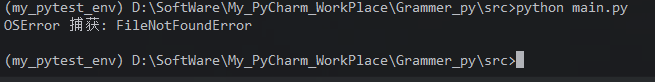


#### 3.4 顺序错误：宽泛在前导致具体分支失效

```python
try:
    int("abc")
except Exception as e:
    print("宽泛分支")       # 匹配
except ValueError as e:
    print("具体分支")       # 永远不会执行
```

**这是常见错误**。应**具体异常在前，宽泛异常在后**：

```python
try:
    int("abc")
except ValueError as e:
    print("具体分支")       # 匹配
except Exception as e:
    print("宽泛分支")       # 不执行
```

>   **记忆口诀**：**从具体到宽泛，从子类到父类**。


#### 3.5 示例：文件与数据操作

```python
import json

def load_config(path):
    try:
        with open(path, encoding="utf-8") as f:
            text = f.read()
        config = json.loads(text)
        port = int(config["port"])
        return config
    except FileNotFoundError:
        print(f"文件不存在: {path}")
        return None
    except PermissionError:
        print(f"无权限读取: {path}")
        return None
    except json.JSONDecodeError as e:
        print(f"JSON 格式错误: 行 {e.lineno}, 列 {e.colno}: {e.msg}")
        return None
    except (KeyError, ValueError) as e:
        print(f"配置项无效: {type(e).__name__}: {e}")
        return None
    except OSError as e:
        print(f"其他 I/O 错误: {e}")
        return None
```

**解析**：

-   `FileNotFoundError`、`PermissionError` 是 `OSError` 的子类，放在 `OSError` 之前。
-   `json.JSONDecodeError` 是 `ValueError` 的子类，放在 `ValueError` 之前。
-   最后用 `OSError` 兜底其他 I/O 错误。

**顺序验证**：

```python
import json
print(issubclass(json.JSONDecodeError, ValueError))   # True
print(issubclass(FileNotFoundError, OSError))         # True
print(issubclass(PermissionError, OSError))           # True
```

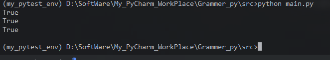


### 4、元组形式 vs 多个 `except` 分支

#### 4.1 对比

| 对比项       | 元组形式             | 多个 `except` 分支 |
| :----------- | :------------------- | :----------------- |
| 处理逻辑     | 所有异常**相同**     | 每种异常**不同**   |
| 代码量       | 少                   | 多                 |
| 可读性       | 适合相同逻辑         | 适合区分处理       |
| 获取具体类型 | 需 `isinstance` 判断 | 直接由分支确定     |
| 匹配顺序     | 元组内无顺序问题     | 严格从上到下       |

#### 4.2 选择建议

-   **处理逻辑相同** → 用元组：`except (A, B, C) as e:`
-   **处理逻辑不同** → 用多分支：`except A: ... except B: ...`
-   **需要部分相同、部分不同** → 多分支 + 元组组合

```python
try:
    risky()
except (ConnectionError, TimeoutError) as e:
    # 网络类错误，统一重试
    retry()
except (ValueError, TypeError) as e:
    # 数据类错误，统一记录并返回默认值
    logger.warning(f"数据错误: {e}")
    return default
except KeyError:
    # 单独处理
    return {}
```


### 5、捕获异常时的类型判断

#### 5.1 `type(e)` 精确匹配

```python
try:
    risky()
except (ValueError, TypeError) as e:
    if type(e) is ValueError:
        print("精确匹配 ValueError")
    elif type(e) is TypeError:
        print("精确匹配 TypeError")
```

`type(e) is X` 不匹配子类。


#### 5.2 `isinstance(e, X)` 包含子类

```python
try:
    int("abc")
except (ValueError, TypeError) as e:
    if isinstance(e, ValueError):
        print("是 ValueError 或其子类")
```

例如 `json.JSONDecodeError` 是 `ValueError` 子类，`isinstance` 判断为 `True`。


#### 5.3 推荐方式

如果确实需要区分类型，**直接使用多个 `except` 分支**比 `isinstance` 判断更清晰：

```python
# 推荐
try:
    risky()
except ValueError as e:
    handle_value(e)
except TypeError as e:
    handle_type(e)

# 不推荐：用 isinstance 在单个 except 中区分
try:
    risky()
except (ValueError, TypeError) as e:
    if isinstance(e, ValueError):
        handle_value(e)
    else:
        handle_type(e)
```


### 6、异常组：`except*`（Python 3.11+）

#### 6.1 背景

Python 3.11 引入了 `ExceptionGroup` 和 `except*`，用于**同时抛出和捕获多个独立异常**。传统 `except` 只能捕获单个异常，而 `ExceptionGroup` 可以打包多个异常。

#### 6.2 基本语法

```python
try:
    raise ExceptionGroup("多个错误", [
        ValueError("值错误"),
        TypeError("类型错误"),
    ])
except* ValueError as eg:
    print(f"捕获 ValueError 组: {eg.exceptions}")
except* TypeError as eg:
    print(f"捕获 TypeError 组: {eg.exceptions}")
```

**输出**：

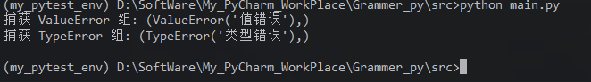


#### 6.3 `except*` 的特点

-   一个 `ExceptionGroup` 中可以包含多种异常。
-   每个 `except*` 分支处理匹配的子组，**多个分支都会执行**（不同于普通 `except`）。
-   未匹配的异常保留在剩余组中，继续传播。

```python
try:
    raise ExceptionGroup("混合错误", [
        ValueError("v1"),
        TypeError("t1"),
        ValueError("v2"),
    ])
except* ValueError as eg:
    print(f"处理 ValueError: {len(eg.exceptions)} 个")
except* TypeError as eg:
    print(f"处理 TypeError: {len(eg.exceptions)} 个")
```

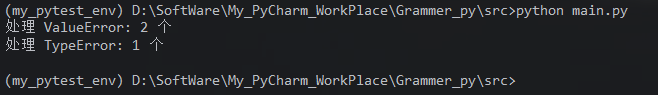


#### 6.4 适用场景

异常组主要用于**并发编程**（`asyncio.TaskGroup`）和**批量处理**，普通业务代码很少需要。Python 3.11 之前不可用，跨版本代码应避免依赖。


### 7、常见陷阱

#### 7.1 顺序错误导致具体分支失效

```python
# 错误
try:
    int("abc")
except Exception:
    print("宽泛")
except ValueError:
    print("具体")   # 永远不执行
```

>   **修复**：具体在前。

#### 7.2 元组中混入非异常类

```python
try:
    pass
except (ValueError, "string"):   # TypeError
    pass
```

>    **修复**：确保元组中所有元素都是异常类。

#### 7.3 忘记 `as` 导致无法获取异常信息

```python
try:
    risky()
except (ValueError, TypeError):
    print("出错了")   # 不知道具体是什么
```

>    **修复**：需要信息时加 `as e`。

#### 7.4 用 `isinstance` 代替多分支

虽然可行，但可读性差，且容易遗漏子类。优先用多分支。

#### 7.5 父子类冗余

```python
try:
    open("x")
except (OSError, FileNotFoundError) as e:   # FileNotFoundError 冗余
    pass
```

>   元组中同时出现父类和子类不会报错，但子类是多余的。

#### 7.6 用元组捕获后静默忽略

```python
try:
    risky()
except (ValueError, TypeError):
    pass   # 吞掉所有错误
```

>   **修复**：至少记录日志，或明确返回错误标识。

#### 7.7 多分支中漏掉 `raise`

```python
try:
    critical()
except ValueError as e:
    logger.error(f"值错误: {e}")
    # 忘记 raise，上层以为成功
except TypeError as e:
    logger.error(f"类型错误: {e}")
    raise
```

>   **修复**：根据业务决定是否重新抛出，保持一致。


### 8、最佳实践

#### 8.1 处理逻辑相同用元组

```python
try:
    data = json.loads(text)
except (json.JSONDecodeError, UnicodeDecodeError) as e:
    logger.warning(f"解析失败: {e}")
    data = {}
```


#### 8.2 处理逻辑不同用多分支

```python
try:
    result = api_call()
except ConnectionError:
    retry_later()
except TimeoutError:
    use_cache()
except HTTPError as e:
    if e.code == 404:
        return None
    raise
```


#### 8.3 具体在前，宽泛在后

```python
try:
    risky()
except FileNotFoundError:
    ...
except PermissionError:
    ...
except OSError:
    ...
except Exception:
    logger.exception("未预期错误")
    raise
```


#### 8.4 用元组时注意子类关系

如果元组中所有异常共享一个父类，直接用父类即可：

```python
# 冗余
except (FileNotFoundError, PermissionError, IsADirectoryError) as e:

# 简洁
except OSError as e:
```


#### 8.5 保留异常上下文

```python
try:
    config = json.loads(text)
except (json.JSONDecodeError, ValueError) as e:
    raise ConfigError("配置解析失败") from e
```


#### 8.6 记录日志时包含类型

```python
try:
    risky()
except (ValueError, TypeError) as e:
    logger.warning(f"{type(e).__name__}: {e}")
```


#### 8.7 不要捕获 `BaseException`

```python
# 危险：会捕获 KeyboardInterrupt、SystemExit
except (ValueError, BaseException):
    pass

# 正确
except (ValueError, Exception):
    pass
```


### 9、综合示例

#### 9.1 数据转换管道

```python
import json
import logging

logger = logging.getLogger(__name__)

def transform(raw_data):
    try:
        data = json.loads(raw_data)
        user_id = int(data["user_id"])
        amount = float(data["amount"])
        if amount <= 0:
            raise ValueError(f"金额必须为正: {amount}")
        return {"user_id": user_id, "amount": amount}
    except json.JSONDecodeError as e:
        logger.error(f"JSON 格式错误: 行 {e.lineno} 列 {e.colno}: {e.msg}")
        return None
    except KeyError as e:
        logger.error(f"缺少字段: {e}")
        return None
    except (TypeError, ValueError) as e:
        logger.error(f"数据类型或值无效: {type(e).__name__}: {e}")
        return None
```


#### 9.2 网络请求重试

```python
import time

def fetch_with_retry(url, max_attempts=3):
    last_error = None
    for attempt in range(1, max_attempts + 1):
        try:
            return http_get(url)
        except (ConnectionError, TimeoutError) as e:
            last_error = e
            if attempt < max_attempts:
                time.sleep(2 ** attempt)
        except ValueError as e:
            # 非临时性错误，不重试
            logger.error(f"请求参数错误: {e}")
            raise
    raise ConnectionError(f"重试 {max_attempts} 次仍失败") from last_error
```


#### 9.3 文件与数据库操作

```python
def import_records(path, conn):
    try:
        with open(path, encoding="utf-8") as f:
            records = json.load(f)
        conn.begin()
        for record in records:
            conn.insert(record)
        conn.commit()
    except FileNotFoundError as e:
        logger.error(f"文件不存在: {e.filename}")
        raise ImportError("导入文件缺失") from e
    except (json.JSONDecodeError, UnicodeDecodeError) as e:
        logger.error(f"文件格式错误: {type(e).__name__}: {e}")
        raise ImportError("导入文件格式无效") from e
    except (KeyError, ValueError) as e:
        conn.rollback()
        logger.error(f"记录格式错误: {type(e).__name__}: {e}")
        raise ImportError("记录格式无效") from e
    except OSError as e:
        conn.rollback()
        logger.error(f"数据库操作失败: {e}")
        raise ImportError("数据库操作失败") from e
```


### 10、总结

#### 捕获多个异常的方式

| 方式     | 语法                          | 适用场景         |
| :------- | :---------------------------- | :--------------- |
| 元组形式 | `except (A, B, C) as e:`      | 处理逻辑相同     |
| 多个分支 | `except A: ... except B: ...` | 处理逻辑不同     |
| 异常组   | `except* A:`                  | 3.11+，并发/批量 |

#### 匹配规则

| 规则     | 说明                                     |
| :------- | :--------------------------------------- |
| 从上到下 | 第一个匹配的 `except` 执行，后续不再检查 |
| 基于继承 | 父类的 `except` 能捕获子类异常           |
| 具体在前 | 子类/具体异常写在父类/宽泛异常之前       |
| 元组匹配 | 元组内任意一个匹配即捕获，`e` 为实际类型 |

#### 核心原则

1.  **处理逻辑相同用元组，不同用多分支**。
2.  **具体异常在前，宽泛异常在后**，避免具体分支失效。
3.  **元组中元素必须是异常类**，否则运行时 `TypeError`。
4.  **父子类冗余无意义**，直接用父类即可。
5.  **需要区分类型时优先多分支**，而非 `isinstance`。
6.  **避免静默吞异常**，至少记录日志或返回错误标识。
7.  **不要捕获 `BaseException`**，避免吞掉 `KeyboardInterrupt`。
8.  **保留异常上下文**，使用 `raise ... from ...`。
9.  **异常组适用于并发/批量场景**，普通业务代码谨慎使用。


## 12.4 异常的传播与重新抛出（raise）

异常处理不只是“捕获”，还包括**异常的传播**和**重新抛出**。理解异常如何在调用栈中传播、`raise` 的各种用法、异常链的机制，是编写健壮程序的关键。

### 1、异常的传播机制

#### 1.1 什么是异常传播

当异常在当前函数中**没有被捕获**时，它会**向上传播**到调用者。如果调用者也没有捕获，继续向上传播，直到：

-   被某个 `except` 捕获。
-   传播到程序顶层，Python 打印回溯并终止程序。

```python
def a():
    return 1 / 0          # 抛出 ZeroDivisionError

def b():
    return a()            # 未捕获，向上传播

def c():
    return b()            # 未捕获，向上传播

c()   # 传播到顶层，程序终止
```

**输出**：

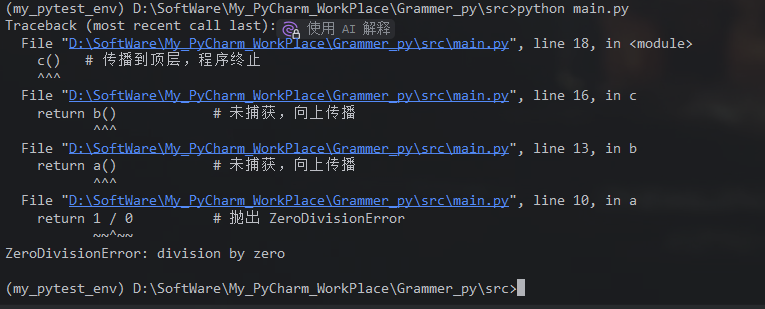

**阅读回溯**：从上到下是调用链（`c` → `b` → `a`），最底部是实际出错位置和异常类型。


#### 1.2 传播过程中的关键点

##### (1) 异常传播不会回滚已执行的代码

```python
data = []
try:
    data.append(1)
    1 / 0
    data.append(2)      # 不会执行
except ZeroDivisionError:
    pass
print(data)   # [1]，append(1) 已生效
```

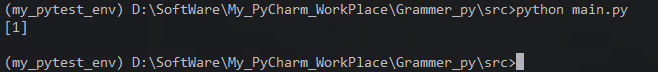

##### (2) `finally` 在传播过程中仍会执行

```python
def f():
    try:
        1 / 0
    finally:
        print("finally 执行")

try:
    f()
except ZeroDivisionError:
    print("外部捕获")
```

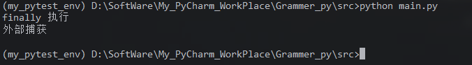

##### (3) 传播到顶层时的默认行为

-   打印回溯到 `sys.stderr`。
-   程序以非零状态码退出（通常为 `1`）。
-   所有 `finally` 块已执行。
-   `__del__` 可能被调用（时机不确定）。


#### 1.3 传播与 `__context__`（隐式异常链）

当在 `except` 块中**又抛出**新异常时，原异常会被保存在新异常的 `__context__` 中，形成**隐式异常链**。

```python
try:
    try:
        1 / 0
    except ZeroDivisionError:
        raise ValueError("转换错误")   # 在 except 中抛出
except ValueError as e:
    print(f"当前异常: {e}")
    print(f"上下文异常: {e.__context__}")
    print(f"上下文类型: {type(e.__context__).__name__}")
```

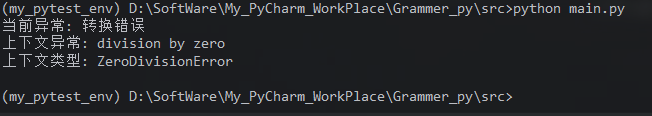

Python 默认会同时显示两个异常：

```text
Traceback (most recent call last):
  ...
ZeroDivisionError: division by zero

During handling of the above exception, another exception occurred:

Traceback (most recent call last):
  ...
ValueError: 转换错误
```

关键提示语：**"During handling of the above exception, another exception occurred"**。


### 2、`raise` 语句的多种形式

#### 2.1 抛出异常类（自动实例化）

```python
raise ValueError
```

等价于：

```python
raise ValueError()
```

>   **注意**：会自动实例化，但不带任何消息。通常不推荐，因为缺少错误信息。


#### 2.2 抛出异常实例（推荐）

```python
raise ValueError("无效的值: abc")
```

-   可以携带任意参数。
-   `e.args` 保存参数元组。
-   推荐这种方式，便于调试和日志。

```python
try:
    raise ValueError("无效的值", "abc", 42)
except ValueError as e:
    print(e.args)   # ('无效的值', 'abc', 42)
```

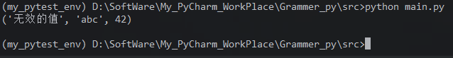


#### 2.3 不带参数的 `raise`：重新抛出

在 `except` 块中，`raise` 不带参数时，**重新抛出当前正在处理的异常**，保留原始回溯。

```python
def process():
    try:
        1 / 0
    except ZeroDivisionError:
        print("记录日志")
        raise   # 重新抛出

try:
    process()
except ZeroDivisionError as e:
    print(f"外部捕获: {e}")
```

**回溯信息完整保留**，包括 `process()` 内部的行号。

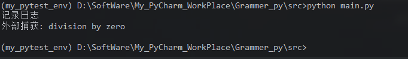

>   **重要**：`raise` 不带参数只能在 `except` 块中使用，否则抛出 `RuntimeError`：

```python
raise   # RuntimeError: No active exception to reraise
```


#### 2.4 `raise ... from ...`：显式异常链

```python
try:
    config = json.loads(text)
except json.JSONDecodeError as e:
    raise ConfigError("配置格式错误") from e
```

**输出**：

```text
json.JSONDecodeError: Expecting value: line 1 column 1 (char 0)

The above exception was the direct cause of the following exception:

Traceback (most recent call last):
  ...
ConfigError: 配置格式错误
```

>   关键提示语：**"The above exception was the direct cause of the following exception"**。

`from e` 设置新异常的 `__cause__` 为 `e`，明确表示“**由 e 直接导致**”。


#### 2.5 `raise ... from None`：抑制异常链

```python
try:
    int("abc")
except ValueError:
    raise RuntimeError("解析失败") from None
```

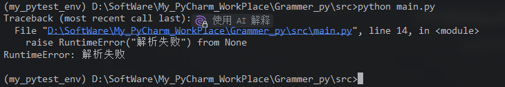

原始 `ValueError` 被完全隐藏，只显示新异常。适用于：

-   原始异常对调用者无意义。
-   希望简化错误信息。
-   安全考虑，不暴露内部细节。


#### 2.6 `raise` 的形式对比

| 形式                       | 示例                                | 用途                 | 异常链                  |
| :------------------------- | :---------------------------------- | :------------------- | :---------------------- |
| `raise Exc`                | `raise ValueError`                  | 抛出类（自动实例化） | 无                      |
| `raise Exc(...)`           | `raise ValueError("msg")`           | 抛出实例             | 无                      |
| `raise`                    | `raise`                             | 重新抛出当前异常     | 保留原始回溯            |
| `raise Exc(...) from e`    | `raise ConfigError(...) from e`     | 显式异常链           | 设置 `__cause__`        |
| `raise Exc(...) from None` | `raise RuntimeError(...) from None` | 抑制异常链           | 设置 `__cause__ = None` |


#### 2.7 只能抛出 `BaseException` 子类

```python
raise "字符串"   # TypeError: exceptions must derive from BaseException
raise 42         # TypeError

# 正确
raise ValueError("消息")
raise Exception
```

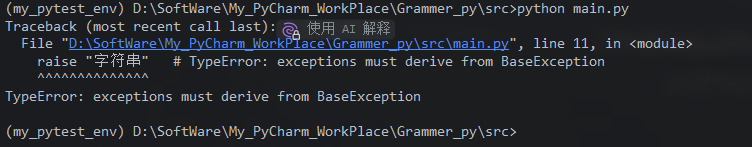

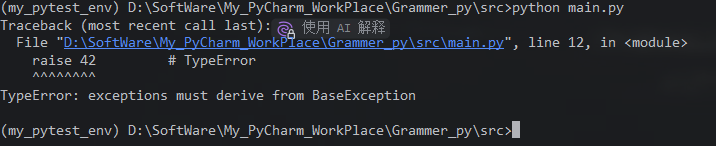

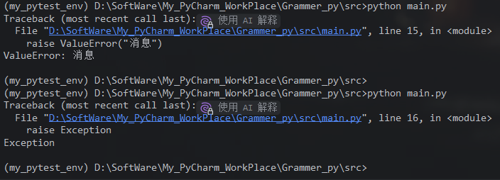


#### 2.8 抛出非异常对象

如果 `raise` 的对象不是异常类或实例，会抛出 `TypeError`：

```python
try:
    raise "错误"   # TypeError
except TypeError as e:
    print(e)   # exceptions must derive from BaseException
```


### 3、异常链详解

#### 3.1 `__cause__` 与 `__context__` 的区别

| 属性                   | 触发方式                          | 含义                          | 显示方式                                      |
| :--------------------- | :-------------------------------- | :---------------------------- | :-------------------------------------------- |
| `__cause__`            | `raise ... from ...`              | **显式**指定的原因            | "The above exception was the direct cause..." |
| `__context__`          | 在 `except` 中抛出异常            | **隐式**发生的上下文          | "During handling of the above exception..."   |
| `__suppress_context__` | `raise ... from None` 或 `from e` | 是否抑制 `__context__` 的显示 | 影响显示                                      |


#### 3.2 `__context__`：隐式链

在 `except` 块中抛出异常时，Python 自动设置 `__context__`：

```python
try:
    try:
        1 / 0
    except ZeroDivisionError:
        raise ValueError("出错")   # 自动设置 __context__ = ZeroDivisionError
except ValueError as e:
    print(f"cause: {e.__cause__}")       # None
    print(f"context: {e.__context__}")   # division by zero
```

**`__cause__` 为 `None`**，因为未使用 `from`。

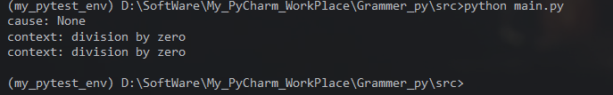


#### 3.3 `__cause__`：显式链

使用 `from e` 时，`__cause__` 被设置：

```python
try:
    try:
        1 / 0
    except ZeroDivisionError as e:
        raise ValueError("出错") from e
except ValueError as e:
    print(f"cause: {e.__cause__}")       # division by zero
    print(f"context: {e.__context__}")   # division by zero（也会自动设置）
```

当使用 `from e` 时，`__cause__` 和 `__context__` 都被设置，但显示时以 `__cause__` 为准。

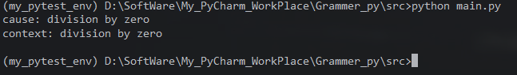


#### 3.4 `from None`：抑制显示

```python
try:
    try:
        1 / 0
    except ZeroDivisionError:
        raise ValueError("出错") from None
except ValueError as e:
    print(f"cause: {e.__cause__}")              # None
    print(f"context: {e.__context__}")          # division by zero（内部仍记录）
    print(f"suppress: {e.__suppress_context__}")  # True
```

`from None` 设置 `__cause__ = None` 且 `__suppress_context__ = True`，Python 显示时**不显示** `__context__`。

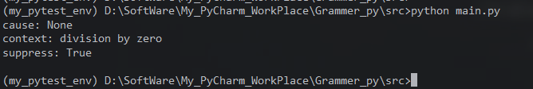


#### 3.5 异常链的传播规则

```python
raise X from Y  → __cause__ = Y, __suppress_context__ = True（显示时以 cause 为准）
raise X         → 在 except 中自动 __context__ = 当前异常
raise X from None → __cause__ = None, __suppress_context__ = True（隐藏 context）
```


#### 3.6 查看异常链

```python
def print_chain(e):
    print(f"异常: {type(e).__name__}: {e}")
    if e.__cause__ is not None:
        print("  原因链:")
        print_chain(e.__cause__)
    elif e.__context__ is not None and not e.__suppress_context__:
        print("  上下文链:")
        print_chain(e.__context__)

try:
    try:
        1 / 0
    except ZeroDivisionError as e:
        raise ValueError("上层错误") from e
except ValueError as e:
    print_chain(e)
```

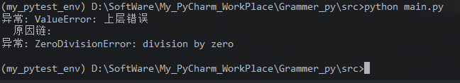


### 4、重新抛出的时机与方式

#### 4.1 记录日志后重新抛出

最常见的场景：在中间层记录日志，然后重新抛出，让上层决定如何处理。

```python
import logging

logger = logging.getLogger(__name__)

def process(data):
    try:
        return transform(data)
    except ValueError as e:
        logger.error(f"transform 失败: {e}")
        raise   # 原样重新抛出，保留回溯
```

**推荐使用不带参数的 `raise`**，保留完整的回溯信息。


#### 4.2 转换为更有意义的异常

```python
class DataProcessingError(Exception):
    """数据处理错误"""

def process(data):
    try:
        return transform(data)
    except (KeyError, ValueError, TypeError) as e:
        raise DataProcessingError(f"数据处理失败: {data}") from e
```

**优势**：

-   上层只需捕获 `DataProcessingError`，不必了解底层异常。
-   `from e` 保留原始异常，便于调试。
-   异常链清晰显示“直接原因”。


#### 4.3 重新抛出 vs 转换异常

| 方式         | 适用场景                            | 示例                                 |
| :----------- | :---------------------------------- | :----------------------------------- |
| 原样重新抛出 | 中间层只做日志/监控，不改变异常语义 | `except Exception: logger...; raise` |
| 转换异常     | 隐藏实现细节，暴露接口层异常        | `raise AppError(...) from e`         |
| 抑制链       | 原始异常对调用者无意义              | `raise AppError(...) from None`      |


#### 4.4 `raise` 重新抛出与 `raise e` 的区别

```python
# 方式一：不带参数的 raise（推荐）
try:
    risky()
except ValueError:
    raise   # 保留完整回溯

# 方式二：raise e（不推荐）
try:
    risky()
except ValueError as e:
    raise e   # 修改回溯的起点，丢失部分信息
```

**区别**：

-   `raise`：原样重新抛出，回溯**完全保留**。
-   `raise e`：重新抛出同一个异常对象，但**回溯的起点变为 `raise e` 所在行**，原始调用链被切断。

**示例对比**：

```python
def inner():
    1 / 0

def middle_reraise():
    try:
        inner()
    except ZeroDivisionError:
        raise   # 保留 inner 的回溯

def middle_raise_e():
    try:
        inner()
    except ZeroDivisionError as e:
        raise e   # 回溯从 raise e 开始，丢失 inner

# middle_reraise 的回溯：
#   File "...", line X, in middle_reraise
#     inner()
#   File "...", line Y, in inner
#     1 / 0

# middle_raise_e 的回溯：
#   File "...", line X, in middle_raise_e
#     raise e   ← 起点变了
```

**结论**：重新抛出时**优先用 `raise`**，避免用 `raise e`。

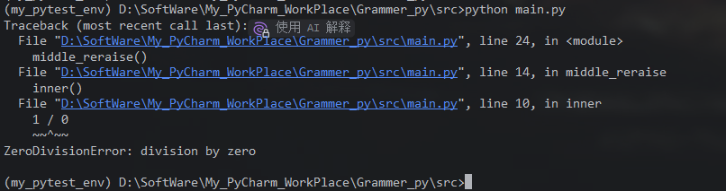


#### 4.5 在 `except` 外重新抛出

`raise e` 可以在 `except` 外使用（但 `raise` 不行）：

```python
saved_exc = None
try:
    risky()
except ValueError as e:
    saved_exc = e

if saved_exc is not None:
    raise saved_exc   # 可以，但回溯起点为 raise 所在行
```

更好的做法是保存异常使用 `with_traceback` 保留回溯，或重新设计代码避免这种模式。


### 5、异常传播与 `finally` 的交互

#### 5.1 `finally` 中的 `raise` 替换原异常

```python
try:
    try:
        raise ValueError("原始")
    finally:
        raise RuntimeError("finally 错误")
except RuntimeError as e:
    print(f"捕获: {e}")
    print(f"上下文: {e.__context__}")
```

原始 `ValueError` 保存在 `RuntimeError.__context__` 中。


#### 5.2 `finally` 中的 `return` 吞掉异常

```python
def f():
    try:
        raise ValueError("错误")
    finally:
        return "ok"   # 吞掉异常

print(f())   # ok，异常被吞
```

**这是危险行为**，应避免在 `finally` 中 `return`/`break`/`continue`。


#### 5.3 传播过程中 `finally` 一定执行

```python
def process():
    try:
        return risky()
    finally:
        print("清理")

try:
    process()
except Exception as e:
    print(f"捕获: {e}")
```

无论 `risky()` 成功还是抛出异常，`finally` 都会执行。


### 6、异常传播与上下文管理器

#### 6.1 `__exit__` 中的异常处理

`with` 语句的 `__exit__` 接收异常信息，可以通过返回值决定是否抑制：

```python
class Suppress:
    def __enter__(self):
        return self

    def __exit__(self, exc_type, exc_val, exc_tb):
        if exc_type is ValueError:
            return True   # 抑制 ValueError
        return False      # 其他异常传播

with Suppress():
    raise ValueError("被抑制")
print("继续")

try:
    with Suppress():
        raise TypeError("不被抑制")
except TypeError as e:
    print(f"捕获: {e}")
```


#### 6.2 `__exit__` 中重新抛出

```python
class Logger:
    def __enter__(self):
        return self

    def __exit__(self, exc_type, exc_val, exc_tb):
        if exc_type:
            logger.error(f"发生异常: {exc_type.__name__}: {exc_val}")
        return False   # 不抑制，异常继续传播
```


#### 6.3 `__exit__` 中抛出新异常

```python
class ConvertError:
    def __enter__(self):
        return self

    def __exit__(self, exc_type, exc_val, exc_tb):
        if exc_type is ValueError:
            raise AppError("转换失败") from exc_val
        return False
```

新异常替换原异常，原异常保存在 `__cause__` 中。


### 7、上下文管理器中的异常传播

#### 7.1 `with` 块中的异常传播到 `__exit__`

```python
class Manager:
    def __enter__(self):
        print("进入")
        return self

    def __exit__(self, exc_type, exc_val, exc_tb):
        print(f"退出，异常类型: {exc_type}")
        return False

with Manager():
    raise ValueError("错误")
# 输出：
# 进入
# 退出，异常类型: <class 'ValueError'>
# Traceback...
```


#### 7.2 `__exit__` 返回值对传播的影响

| `__exit__` 返回值 | 异常传播     |
| :---------------- | :----------- |
| `True`（真值）    | 抑制，不传播 |
| `False` / `None`  | 继续传播     |
| 抛出新异常        | 替换原异常   |


### 8、常见陷阱

#### 8.1 `raise e` 丢失原始回溯

```python
try:
    risky()
except ValueError as e:
    raise e   # 回溯起点变为 raise e 所在行
```

>   **修复**：使用不带参数的 `raise`。

```python
try:
    risky()
except ValueError:
    raise
```


#### 8.2 在 `except` 外使用裸 `raise`

```python
try:
    risky()
except ValueError as e:
    saved = e

raise   # RuntimeError: No active exception to reraise
```

>   **修复**：使用 `raise saved`（但会丢失部分回溯）或在 `except` 内重新抛出。


#### 8.3 忘记 `from` 导致异常链混乱

```python
try:
    parse()
except ValueError:
    raise AppError("解析失败")   # 隐式 __context__，显示 "During handling..."
```

>   **修复**：使用 `from` 明确因果关系：

```python
try:
    parse()
except ValueError as e:
    raise AppError("解析失败") from e
```


#### 8.4 `from None` 过度使用

```python
try:
    critical_operation()
except Exception:
    raise AppError("操作失败") from None   # 丢失所有诊断信息
```

>   **修复**：只有在原始异常确实无意义时才用 `from None`，否则保留链。


#### 8.5 捕获后静默忽略

```python
try:
    risky()
except Exception:
    pass   # 异常被吞，问题被隐藏
```

>   **修复**：至少记录日志，或重新抛出。


#### 8.6 异常链被 `finally` 中的 `raise` 掩盖

```python
try:
    try:
        raise ValueError("原始")
    finally:
        raise RuntimeError("finally")   # 掩盖原始
except RuntimeError as e:
    print(e)              # finally
    print(e.__context__)  # 原始（仍可访问）
```

**修复**：`finally` 中不要随意抛出异常。


#### 8.7 在生成器中传播 `StopIteration`

```python
def gen():
    yield 1
    raise StopIteration("自定义消息")   # 不推荐

list(gen())   # RuntimeError: generator raised StopIteration（PEP 479）
```

Python 3.7+ 中，生成器内抛出 `StopIteration` 会被转换为 `RuntimeError`。应使用 `return` 结束生成器。


### 9、最佳实践

#### 9.1 重新抛出用裸 `raise`

```python
try:
    risky()
except SpecificError:
    logger.error("失败")
    raise   # 保留完整回溯
```


#### 9.2 转换异常用 `from`

```python
try:
    risky()
except LowLevelError as e:
    raise HighLevelError("高层错误") from e
```


#### 9.3 抑制链用 `from None`（谨慎）

```python
try:
    internal()
except InternalError:
    raise UserFacingError("操作失败") from None
```


#### 9.4 异常链层次清晰

```python
class AppError(Exception):
    """应用基础异常"""

class ValidationError(AppError):
    pass

class NotFoundError(AppError):
    pass

def get_user(user_id):
    try:
        return db.query(user_id)
    except DatabaseError as e:
        raise AppError(f"查询用户失败: {user_id}") from e
```


#### 9.5 不要用异常控制正常流程

```python
# 不好
try:
    value = data[key]
except KeyError:
    value = default

# 好
value = data.get(key, default)
```


#### 9.6 记录日志时使用 `logger.exception`

在 `except` 块中，`logger.exception` 自动记录异常和回溯：

```python
try:
    risky()
except Exception:
    logger.exception("操作失败")   # 包含完整回溯
    raise
```


#### 9.7 异常传播的边界

在模块边界（如 API 层）应转换异常：

```python
def api_handler(request):
    try:
        return process(request)
    except AppError as e:
        return {"error": str(e)}, 400
    except Exception:
        logger.exception("未预期错误")
        return {"error": "内部错误"}, 500
```


#### 9.8 `raise` 的语义清晰

```python
# 明确表达“为什么抛”
raise ValueError(f"年龄必须在 0-150 之间，实际: {age}")

# 避免模糊
raise ValueError("错误")   # 信息不足
```


### 10、综合示例

#### 10.1 分层异常转换

```python
import json
import logging

logger = logging.getLogger(__name__)

class AppError(Exception):
    """应用基础异常"""

class ConfigError(AppError):
    """配置错误"""

class DatabaseError(AppError):
    """数据库错误"""

def load_config(path):
    try:
        with open(path, encoding="utf-8") as f:
            text = f.read()
    except FileNotFoundError as e:
        raise ConfigError(f"配置文件不存在: {path}") from e
    except PermissionError as e:
        raise ConfigError(f"无权限读取: {path}") from e
    except OSError as e:
        raise ConfigError(f"读取失败: {e}") from e

    try:
        return json.loads(text)
    except json.JSONDecodeError as e:
        raise ConfigError(f"JSON 格式错误: 行 {e.lineno}, 列 {e.colno}") from e

def query_user(user_id):
    try:
        return db.query(user_id)
    except DatabaseConnectionError as e:
        raise DatabaseError("数据库连接失败") from e
    except DatabaseQueryError as e:
        raise DatabaseError(f"查询失败: {user_id}") from e

def main():
    try:
        config = load_config("config.json")
        user = query_user(1)
    except ConfigError as e:
        logger.error(f"配置错误: {e}")
        return 1
    except DatabaseError as e:
        logger.error(f"数据库错误: {e}")
        return 2
    except AppError as e:
        logger.error(f"应用错误: {e}")
        return 3
    except Exception:
        logger.exception("未预期错误")
        return 99
```


#### 10.2 重试机制中的异常传播

```python
import time

def retry(func, max_attempts=3, delay=1.0, retry_exceptions=(ConnectionError,)):
    last_error = None
    for attempt in range(1, max_attempts + 1):
        try:
            return func()
        except retry_exceptions as e:
            last_error = e
            if attempt < max_attempts:
                time.sleep(delay)
        except Exception:
            # 非重试异常，直接传播
            raise
    raise RuntimeError(f"重试 {max_attempts} 次仍失败") from last_error
```


#### 10.3 中间件中的异常记录与重新抛出

```python
def middleware(func):
    def wrapper(*args, **kwargs):
        try:
            return func(*args, **kwargs)
        except AppError:
            logger.warning(f"{func.__name__} 应用错误", exc_info=True)
            raise
        except Exception as e:
            logger.exception(f"{func.__name__} 未预期错误")
            raise
    return wrapper

@middleware
def handle_request(request):
    ...
```


### 11、总结

#### 异常传播

| 要点      | 说明                                               |
| :-------- | :------------------------------------------------- |
| 传播方向  | 从出错点向调用栈上层传播                           |
| 终止条件  | 被 `except` 捕获，或传播到顶层终止程序             |
| `finally` | 传播过程中一定执行                                 |
| 副作用    | 传播不回滚已执行的代码                             |
| 隐式链    | 在 `except` 中抛出异常时，`__context__` 记录原异常 |

#### `raise` 形式

| 形式                       | 用途                     | 异常链                                 |
| :------------------------- | :----------------------- | :------------------------------------- |
| `raise`                    | 重新抛出当前异常（推荐） | 完整保留回溯                           |
| `raise e`                  | 重新抛出（不推荐）       | 回溯起点改变                           |
| `raise Exc(...)`           | 抛出新异常               | 无                                     |
| `raise Exc(...) from e`    | 显式异常链               | `__cause__ = e`                        |
| `raise Exc(...) from None` | 抑制链                   | `__cause__ = None`，隐藏 `__context__` |

#### 异常链

| 属性                   | 来源                   | 显示                                          |
| :--------------------- | :--------------------- | :-------------------------------------------- |
| `__cause__`            | `raise ... from ...`   | "The above exception was the direct cause..." |
| `__context__`          | `except` 中抛出        | "During handling of the above exception..."   |
| `__suppress_context__` | `from None` / `from e` | 是否隐藏 `__context__`                        |

#### 核心原则

1.  **重新抛出用裸 `raise`**，保留完整回溯。
2.  **转换异常用 `from e`**，明确因果关系。
3.  **隐藏内部细节用 `from None`**，谨慎使用。
4.  **避免在 `finally` 中 `raise`/`return`**，避免掩盖原始异常。
5.  **`except` 中记录日志后重新抛出**，不要静默吞掉。
6.  **在模块边界转换异常**，暴露有意义的接口异常。
7.  **不要用 `raise e`**，用 `raise` 重新抛出。
8.  **异常链要清晰**，避免层层包装后无法追溯根因。


## 12.5 自定义异常类

Python 内置异常（`ValueError`、`TypeError`、`FileNotFoundError` 等）覆盖了通用错误，但在实际项目中，我们往往需要表达**业务语义**的错误，例如“余额不足”、“库存不足”、“权限拒绝”。此时应定义**自定义异常类**。自定义异常让错误处理更精确、日志更清晰、API 契约更明确。

### 1、为什么需要自定义异常

#### 1.1 内置异常的局限

```python
def withdraw(account, amount):
    if amount > account.balance:
        raise ValueError("余额不足")
```

问题：

-   `ValueError` 太宽泛，调用者无法区分“余额不足”和“参数格式错误”。
-   上层只能捕获 `ValueError`，可能误捕获其他无关错误。
-   日志中只看到 `ValueError`，无法快速定位业务问题。


#### 1.2 自定义异常的优势

```python
class InsufficientFundsError(Exception):
    """余额不足"""

def withdraw(account, amount):
    if amount > account.balance:
        raise InsufficientFundsError(f"余额不足: 需要 {amount}, 可用 {account.balance}")
```


**优势**：

| 优势           | 说明                                                         |
| :------------- | :----------------------------------------------------------- |
| **精确捕获**   | 上层可 `except InsufficientFundsError`，不影响其他 `ValueError` |
| **语义清晰**   | 异常名即业务含义，代码自解释                                 |
| **携带上下文** | 可附加余额、账户等结构化信息                                 |
| **统一处理**   | 可为业务异常建立层次，统一捕获                               |
| **API 契约**   | 函数文档明确声明可能抛出的业务异常                           |


### 2、基本定义方式

#### 2.1 最简单的自定义异常

```python
class MyError(Exception):
    pass

try:
    raise MyError("出错了")
except MyError as e:
    print(f"捕获: {e}")   # 捕获: 出错了
```

**要点**：

-   必须继承 `Exception`（或 `Exception` 的子类）。
-   类体可以为空（`pass`）。
-   继承 `Exception` 后自动获得 `args`、`__str__` 等行为。


#### 2.2 不要继承 `BaseException`

```python
# 错误：继承 BaseException 会被 except Exception 漏掉
class BadError(BaseException):
    pass

try:
    raise BadError()
except Exception:
    print("不会捕获")   # 不会执行
```

>   **原则**：自定义异常**必须继承 `Exception`**，除非有极特殊需求（如系统级退出）。继承 `BaseException` 会导致 `except Exception` 无法捕获，且可能被误认为 `SystemExit` 类似的系统异常。


#### 2.3 继承内置异常

如果自定义异常是某类内置错误的细分，可以继承对应的内置异常：

```python
class InvalidEmailError(ValueError):
    """邮箱格式无效"""
    pass

class ConfigFileNotFoundError(FileNotFoundError):
    """配置文件不存在"""
    pass
```

**优势**：

-   上层既可以用 `except InvalidEmailError` 精确捕获，也可以用 `except ValueError` 宽泛捕获。
-   与内置异常体系兼容。

>   **注意**：继承内置异常时，某些内置异常有特殊的构造参数（如 `OSError` 的 `errno`、`filename`），重写 `__init__` 时需谨慎。


### 3、建立异常层次结构

#### 3.1 为什么需要基类异常

大型项目中，业务异常可能有很多种。定义一个**应用级基类异常**，所有业务异常继承它，可以实现：

-   统一捕获所有业务异常：`except AppError`
-   区分业务异常和系统异常
-   统一日志记录和处理


## 12.6 异常链（raise ... from ...）

## 12.7 断言（assert）与防御性编程

## 12.8 异常处理的最佳实践

## 12.9 上下文管理器与异常处理