# 第十二章 异常处理

## 12.1 异常的概念与分类

异常（Exception）是 Python 中处理运行时错误的核心机制。理解异常的概念、产生原因和分类体系，是编写健壮程序的基础。

### 1、异常的概念

#### 1.1 什么是异常

**异常**是程序在运行过程中发生的**非正常事件**，它会中断正常的指令流。当 Python 检测到一个它无法处理的错误时，就会**抛出（raise）**一个异常对象。

```python
print(10 / 0)
```

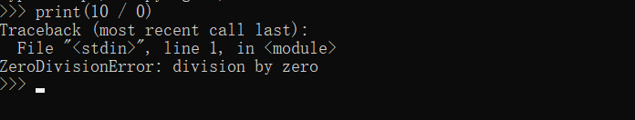

`ZeroDivisionError` 就是一个异常对象。如果没有被捕获，程序会终止，并打印**回溯信息（traceback）**。


#### 1.2 异常 vs 错误

日常交流中“错误”和“异常”常被混用，但在 Python 中有区别：

| 概念                        | 说明                                                     | 示例                 |
| :-------------------------- | :------------------------------------------------------- | :------------------- |
| **语法错误（SyntaxError）** | 代码不符合 Python 语法，**编译阶段**就被检测到，无法运行 | `if True print("x")` |
| **运行时错误（异常）**      | 语法正确，但运行过程中出现问题                           | `1/0`、`int("abc")`  |
| **逻辑错误**                | 程序能运行，但结果不符合预期                             | 算法写错，不会抛异常 |

**语法错误示例**：

```python
# 语法错误，解释器直接拒绝执行
if True
    print("hello")
```

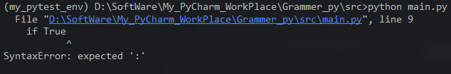

**注意**：`SyntaxError` 虽然名字带 Error，但它也是 `Exception` 的子类，只是发生在编译阶段。


#### 1.3 异常处理的意义

没有异常处理时，任何运行时错误都会导致程序崩溃：

```python
def read_config(path):
    with open(path) as f:
        return f.read()

read_config("不存在的文件.txt")   # FileNotFoundError，程序终止
```

异常处理允许我们：

1.  **捕获并恢复**：对可预期的错误做出响应，程序继续运行。
2.  **资源清理**：确保文件、连接、锁等被释放。
3.  **错误传播**：将错误转换为更有意义的异常，向上层报告。
4.  **分离错误处理与业务逻辑**：主流程保持清晰。


#### 1.4 异常的本质：对象

异常是**类的实例**。抛出异常实际上是抛出某个异常类的实例。

```python
e = ValueError("无效的值")
print(type(e))        # <class 'ValueError'>
print(e.args)         # ('无效的值',)
print(str(e))         # 无效的值
```

`raise ValueError("无效的值")` 等价于：

```python
raise ValueError("无效的值")
```

Python 会自动实例化。也可以先创建再抛出：

```python
exc = ValueError("无效的值")
raise exc
```


### 2、异常的分类

#### 2.1 异常层次结构总览

**查看完整层次**：

```python
import builtins

def print_tree(cls, indent=0):
    print("  " * indent + cls.__name__)
    for sub in sorted(cls.__subclasses__(), key=lambda c: c.__name__):
        print_tree(sub, indent + 1)

print_tree(BaseException)
```

Python 所有异常都继承自 `BaseException`。层次结构如下：	

```python
BaseException
├── SystemExit                     # sys.exit() 抛出
├── KeyboardInterrupt              # Ctrl+C 抛出
├── GeneratorExit                  # 生成器/协程关闭时抛出
└── Exception                      # 绝大多数异常的基类
    ├── ArithmeticError
    │   ├── FloatingPointError
    │   ├── OverflowError
    │   └── ZeroDivisionError
    ├── AssertionError
    ├── AttributeError
    ├── BufferError
    ├── EOFError
    ├── ImportError
    │   └── ModuleNotFoundError
    ├── LookupError
    │   ├── IndexError
    │   └── KeyError
    ├── MemoryError
    ├── NameError
    │   └── UnboundLocalError
    ├── OSError
    │   ├── BlockingIOError
    │   ├── ChildProcessError
    │   ├── ConnectionError
    │   │   ├── BrokenPipeError
    │   │   ├── ConnectionAbortedError
    │   │   ├── ConnectionRefusedError
    │   │   └── ConnectionResetError
    │   ├── FileExistsError
    │   ├── FileNotFoundError
    │   ├── InterruptedError
    │   ├── IsADirectoryError
    │   ├── NotADirectoryError
    │   ├── PermissionError
    │   ├── ProcessLookupError
    │   └── TimeoutError
    ├── ReferenceError
    ├── RuntimeError
    │   ├── NotImplementedError
    │   ├── RecursionError
    │   └── PythonFinalizationError
    ├── StopAsyncIteration
    ├── StopIteration
    ├── SyntaxError
    │   └── IndentationError
    │       └── TabError
    ├── SystemError
    ├── TypeError
    ├── ValueError
    │   └── UnicodeError
    │       ├── UnicodeDecodeError
    │       ├── UnicodeEncodeError
    │       └── UnicodeTranslateError
    └── Warning
        ├── DeprecationWarning
        ├── PendingDeprecationWarning
        ├── RuntimeWarning
        ├── SyntaxWarning
        ├── UserWarning
        ├── FutureWarning
        ├── ImportWarning
        ├── UnicodeWarning
        ├── BytesWarning
        └── ResourceWarning
```


#### 2.2 `BaseException` 的直接子类

`BaseException` 有四个直接子类，它们**不是**普通业务错误：

| 异常                | 触发场景                      | 是否应捕获                     |
| :------------------ | :---------------------------- | :----------------------------- |
| `SystemExit`        | `sys.exit()` 或 `exit()` 调用 | 通常不应捕获（除非清理后重抛） |
| `KeyboardInterrupt` | 用户按 `Ctrl+C`               | 通常不应捕获（除非清理后重抛） |
| `GeneratorExit`     | 生成器被 `close()` 或垃圾回收 | 不应捕获，用于生成器清理       |
| `Exception`         | 绝大多数普通异常              | 应捕获                         |

**关键原则**：`except Exception` 不会捕获 `SystemExit`、`KeyboardInterrupt`、`GeneratorExit`，这是**故意的设计**，避免程序无法正常退出。捕获它们需要显式写 `except BaseException` 或 `except (SystemExit, KeyboardInterrupt)`。

```python
try:
    sys.exit(0)
except Exception:
    print("这不会执行")
# 程序正常退出
```


#### 2.3 `Exception` 及其常见子类分类

`Exception` 下的异常按语义可分为几大类：

##### 2.3.1 算术与数值类

| 异常                 | 说明                 | 示例             |
| :------------------- | :------------------- | :--------------- |
| `ZeroDivisionError`  | 除数为零             | `1 / 0`          |
| `OverflowError`      | 数值超出范围         | `math.exp(1000)` |
| `FloatingPointError` | 浮点运算错误（罕见） | 需启用特定设置   |

```python
try:
    1 / 0
except ZeroDivisionError as e:
    print(f"除零错误: {e}")
```

##### 2.3.2 查找类（`LookupError`）

| 异常         | 说明         | 示例            |
| :----------- | :----------- | :-------------- |
| `IndexError` | 序列索引越界 | `[1, 2][5]`     |
| `KeyError`   | 字典键不存在 | `{}["missing"]` |

```python
try:
    [1, 2, 3][10]
except IndexError as e:
    print(f"索引越界: {e}")

try:
    {"a": 1}["b"]
except KeyError as e:
    print(f"键不存在: {e}")
```

两者共同父类 `LookupError`，可统一捕获：

```python
try:
    # 可能是索引或键访问
    pass
except LookupError as e:
    print(f"查找失败: {e}")
```

##### 2.3.4 属性与类型类

| 异常             | 说明               | 示例         |
| :--------------- | :----------------- | :----------- |
| `AttributeError` | 对象没有该属性     | `(1).append` |
| `TypeError`      | 类型不匹配         | `1 + "a"`    |
| `ValueError`     | 类型正确但值不合法 | `int("abc")` |

```python
try:
    int("abc")
except ValueError as e:
    print(f"值错误: {e}")

try:
    1 + "a"
except TypeError as e:
    print(f"类型错误: {e}")
```

**`TypeError` 与 `ValueError` 的区别**：

-   `TypeError`：**类型**不对，如 `len(123)`。
-   `ValueError`：类型对，但**值**不合法，如 `int("abc")`。

##### 2.3.5 操作系统与 I/O 类（`OSError`）

Python 3.3+ 中，`OSError` 统一了 `IOError`、`EnvironmentError` 等，并根据 `errno` 派生出细分子类。

| 异常                     | 说明                        |
| :----------------------- | :-------------------------- |
| `FileNotFoundError`      | 文件不存在                  |
| `FileExistsError`        | 文件已存在（如 `os.mkdir`） |
| `PermissionError`        | 权限不足                    |
| `IsADirectoryError`      | 期望文件但得到目录          |
| `NotADirectoryError`     | 期望目录但得到文件          |
| `TimeoutError`           | 操作超时                    |
| `ConnectionError`        | 连接相关错误                |
| `BrokenPipeError`        | 管道断裂                    |
| `ConnectionRefusedError` | 连接被拒绝                  |
| `ConnectionResetError`   | 连接被重置                  |

```python
try:
    open("不存在的文件.txt")
except FileNotFoundError as e:
    print(f"文件不存在: {e.filename}")
except PermissionError as e:
    print(f"权限不足: {e.filename}")
except OSError as e:
    print(f"其他 I/O 错误: {e.errno}, {e.strerror}")
```

**`OSError` 的常用属性**：

-   `errno`：错误码（如 `2` 表示 `ENOENT`）。
-   `strerror`：错误描述。
-   `filename`：相关文件名（部分子类）。

##### 2.3.6 导入类

| 异常                  | 说明                               |
| :-------------------- | :--------------------------------- |
| `ImportError`         | 导入失败（如名称不存在）           |
| `ModuleNotFoundError` | 模块未找到（`ImportError` 的子类） |

```python
try:
    import nonexistent_module
except ModuleNotFoundError as e:
    print(f"模块未找到: {e.name}")

try:
    from math import nonexistent_name
except ImportError as e:
    print(f"导入失败: {e}")
```

##### 2.3.7 迭代类

| 异常                 | 说明                                |
| :------------------- | :---------------------------------- |
| `StopIteration`      | 迭代器耗尽，`next()` 在无元素时抛出 |
| `StopAsyncIteration` | 异步迭代器耗尽                      |

```python
it = iter([1])
next(it)   # 1
next(it)   # StopIteration
```

`StopIteration` 在 `for` 循环中被自动处理，不应在业务代码中随意抛出。

##### 2.3.8 运行时类（`RuntimeError`）

| 异常                      | 说明                       |
| :------------------------ | :------------------------- |
| `RuntimeError`            | 其他异常的统称，如递归过深 |
| `RecursionError`          | 递归超过限制               |
| `NotImplementedError`     | 抽象方法未实现             |
| `PythonFinalizationError` | 解释器关闭期间操作不允许   |

```python
def factorial(n):
    return n * factorial(n - 1)

try:
    factorial(10000)
except RecursionError as e:
    print(f"递归过深: {e}")
```

`NotImplementedError` 常用于抽象基类：

```python
class Shape:
    def area(self):
        raise NotImplementedError("子类必须实现 area")
```

##### 2.3.9 断言类

| 异常             | 说明              |
| :--------------- | :---------------- |
| `AssertionError` | `assert` 语句失败 |

```python
try:
    assert 1 > 2, "1 不应大于 2"
except AssertionError as e:
    print(f"断言失败: {e}")
```

##### 2.3.10 语法类

| 异常               | 说明                                       |
| :----------------- | :----------------------------------------- |
| `SyntaxError`      | 语法错误（编译阶段）                       |
| `IndentationError` | 缩进错误（`SyntaxError` 子类）             |
| `TabError`         | 混用 Tab 和空格（`IndentationError` 子类） |

`SyntaxError` 的常用属性：

-   `filename`：文件名。
-   `lineno`：行号。
-   `offset`：列偏移。
-   `text`：出错代码行。

```python
try:
    compile("if True print(1)", "<string>", "exec")
except SyntaxError as e:
    print(f"语法错误: {e.msg}, 行 {e.lineno}, 列 {e.offset}")
```

##### 2.3.11 Unicode 类

| 异常                    | 说明     |
| :---------------------- | :------- |
| `UnicodeDecodeError`    | 解码失败 |
| `UnicodeEncodeError`    | 编码失败 |
| `UnicodeTranslateError` | 转换失败 |

```python
try:
    b"\xff".decode("utf-8")
except UnicodeDecodeError as e:
    print(f"解码失败: {e}")
```

#### 2.3.12 警告类（`Warning`）

`Warning` 是 `Exception` 的子类，但通常**不会中断程序**，而是通过 `warnings` 模块发出提示。

| 警告                 | 说明             |
| :------------------- | :--------------- |
| `DeprecationWarning` | 弃用警告         |
| `UserWarning`        | 用户自定义警告   |
| `RuntimeWarning`     | 运行时警告       |
| `FutureWarning`      | 未来行为变化警告 |
| `ResourceWarning`    | 资源未关闭警告   |

```python
import warnings

warnings.warn("这是一个自定义警告", UserWarning)
```

警告默认只显示一次，可通过 `warnings.filterwarnings` 控制。


#### 2.4 异常分类的维度

除了按继承层次，异常还可以按其他维度分类：

| 维度           | 类别           | 示例                                               |
| :------------- | :------------- | :------------------------------------------------- |
| **来源**       | 内置异常       | `ValueError`、`TypeError`                          |
|                | 标准库异常     | `json.JSONDecodeError`、`re.error`                 |
|                | 用户自定义异常 | `class MyError(Exception)`                         |
| **可恢复性**   | 可恢复         | `FileNotFoundError`（换路径重试）                  |
|                | 不可恢复       | `MemoryError`（通常无法恢复）                      |
| **可预期性**   | 可预期         | `ValueError`（输入校验）                           |
|                | 不可预期       | `SystemError`（解释器内部错误）                    |
| **是否应捕获** | 应捕获         | `Exception` 子类                                   |
|                | 通常不捕获     | `SystemExit`、`KeyboardInterrupt`、`GeneratorExit` |


#### 2.5 标准库中的自定义异常

标准库模块常定义自己的异常层次，方便精细捕获：

```python
import json

try:
    json.loads("{invalid}")
except json.JSONDecodeError as e:
    print(f"JSON 解析错误: {e.msg} at line {e.lineno} column {e.colno}")
```

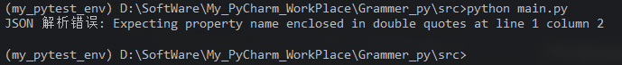

```python
import re

try:
    re.compile("[")
except re.error as e:
    print(f"正则错误: {e}")
```

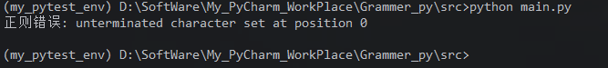

```python
import socket

try:
    socket.create_connection(("localhost", 99999), timeout=1)
except ConnectionRefusedError as e:
    print(f"连接被拒绝: {e}")
except socket.timeout as e:
    print(f"连接超时: {e}")
```

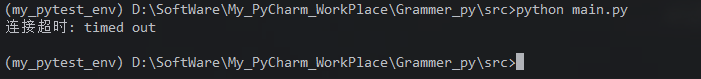

**规律**：标准库异常通常继承自 `Exception`（或相关基类），并提供额外属性（如 `JSONDecodeError.lineno`），便于定位问题。


#### 2.6 用户自定义异常的位置

自定义异常应继承 `Exception`（不要继承 `BaseException`），通常放在模块级：

```python
class AppError(Exception):
    """应用基础异常"""

class ValidationError(AppError):
    """校验错误"""

class NotFoundError(AppError):
    """资源未找到"""
```

**层次设计建议**：

-   定义一个模块级或应用级的**基类异常**，如 `AppError`。
-   所有业务异常继承该基类，便于统一捕获。
-   不要继承 `BaseException`，除非有极特殊需求。

```python
try:
    # 业务逻辑
    pass
except AppError as e:
    # 统一处理所有应用异常
    logger.error(f"应用错误: {e}")
except Exception as e:
    # 兜底处理未预期异常
    logger.exception("未预期错误")
```


### 3、异常对象的结构

#### 3.1 异常实例的常用属性

```python
try:
    open("不存在的文件.txt")
except FileNotFoundError as e:
    print(type(e))          # <class 'FileNotFoundError'>
    print(e.args)           # (2, 'No such file or directory')
    print(e.errno)          # 2
    print(e.strerror)       # No such file or directory
    print(e.filename)       # 不存在的文件.txt
    print(str(e))           # [Errno 2] No such file or directory: '不存在的文件.txt'
```


| 属性            | 说明                               |
| :-------------- | :--------------------------------- |
| `args`          | 构造异常时传入的参数元组           |
| `__cause__`     | 显式异常链（`raise ... from ...`） |
| `__context__`   | 隐式异常链（异常处理中又抛异常）   |
| `__traceback__` | 回溯对象                           |
| `__notes__`     | 附加注释（`add_note()` 添加）      |


#### 3.2 回溯信息（traceback）

异常未被捕获时，Python 打印的 `Traceback` 记录了调用栈，从最外层到出错点：

```python
Traceback (most recent call last):
  File "demo.py", line 10, in <module>
    main()
  File "demo.py", line 6, in main
    1 / 0
ZeroDivisionError: division by zero
```

**阅读顺序**：从上到下是调用链，最底部是实际出错位置和异常类型。


#### 3.3 `raise ... from ...`：显式异常链

```python
try:
    int("abc")
except ValueError as e:
    raise RuntimeError("解析配置失败") from e
```

**输出**

```python
ValueError: invalid literal for int() with base 10: 'abc'

The above exception was the direct cause of the following exception:

RuntimeError: 解析配置失败
```

`from e` 设置 `__cause__`，明确表示“由 e 导致”。


#### 3.4 `raise ... from None`：抑制异常链

```python
try:
    int("abc")
except ValueError:
    raise RuntimeError("解析失败") from None
```

**输出**：

```python
RuntimeError: 解析失败
```

原始 `ValueError` 被隐藏，只显示新异常。


### 4、异常分类的实践意义

#### 4.1 精确捕获

异常层次结构允许我们**由具体到宽泛**地捕获：

```python
try:
    data = open("config.json").read()
    config = json.loads(data)
    port = int(config["port"])
except FileNotFoundError:
    print("配置文件不存在，使用默认配置")
except json.JSONDecodeError as e:
    print(f"配置文件格式错误: {e}")
except (KeyError, ValueError) as e:
    print(f"配置项无效: {e}")
except OSError as e:
    print(f"I/O 错误: {e}")
```

>    **原则**：先捕获具体异常，再捕获宽泛异常。


#### 4.2 避免过度捕获

```python
# 不好：掩盖了所有错误
try:
    process()
except Exception:
    pass

# 好：只捕获预期错误，其他错误应暴露
try:
    process()
except (ValueError, KeyError) as e:
    logger.warning(f"输入无效: {e}")
```


### 4.3 异常类型作为 API 契约

函数的文档字符串应说明可能抛出的异常：

```python
def parse_age(text):
    """
    将字符串解析为年龄。

    Raises:
        ValueError: 文本不是有效整数，或年龄不在 0-150 范围内。
    """
    age = int(text)
    if not 0 <= age <= 150:
        raise ValueError(f"年龄超出范围: {age}")
    return age
```


### 5、总结

#### 异常的概念

| 要点                   | 说明                         |
| :--------------------- | :--------------------------- |
| 异常是运行时非正常事件 | 中断正常指令流               |
| 异常是对象             | 异常类的实例，携带信息       |
| 与语法错误的区别       | 语法错误在编译阶段被拒绝     |
| 异常处理的意义         | 恢复、清理、传播、分离关注点 |

#### 异常的分类

| 层级                                                 | 关键点                                  |
| :--------------------------------------------------- | :-------------------------------------- |
| `BaseException`                                      | 所有异常的根                            |
| `SystemExit` / `KeyboardInterrupt` / `GeneratorExit` | 系统级异常，通常不捕获                  |
| `Exception`                                          | 普通异常的基类，业务代码应捕获          |
| `LookupError`                                        | `IndexError`、`KeyError` 的父类         |
| `OSError`                                            | I/O 错误，按 `errno` 细分               |
| `ArithmeticError`                                    | `ZeroDivisionError`、`OverflowError`    |
| `RuntimeError`                                       | `RecursionError`、`NotImplementedError` |
| `SyntaxError`                                        | 编译阶段异常                            |
| `Warning`                                            | 警告，不中断程序                        |

#### 核心原则

1.  **异常是对象**，携带类型、消息、回溯等丰富信息。
2.  **`Exception` 是业务异常的基类**，不要捕获 `BaseException`。
3.  **`SystemExit`、`KeyboardInterrupt`、`GeneratorExit` 不应被 `except Exception` 捕获**。
4.  **精确捕获**：先具体后宽泛，避免 `except Exception: pass`。
5.  **自定义异常继承 `Exception`**，建立清晰的异常层次。
6.  **异常链**（`raise ... from ...`）保留原始错误上下文。
7.  **异常传播不回滚副作用**，资源清理靠 `finally` 或 `with`。


## 12.2 try-except-else-finally

`try-except-else-finally` 是 Python 异常处理的核心语法结构。它提供了**捕获异常、正常分支处理、无条件清理**的完整机制。

### 1、语法结构总览

```python
try:
    # 可能出错的代码
    risky_operation()
except SomeError as e:
    # 捕获并处理特定异常
    handle_error(e)
except (OtherError, AnotherError) as e:
    # 捕获多个异常
    handle_other(e)
else:
    # try 块没有发生异常时执行
    on_success()
finally:
    # 无论是否发生异常都会执行
    cleanup()
```

**语法规则**：

1.  `try` 块必须存在。
2.  `except` 可以有零个或多个。
3.  `else` 可选，但**必须跟在至少一个 `except` 之后**，且**不能单独与 `finally` 搭配**。
4.  `finally` 可选。
5.  `try` 块后面必须至少有一个 `except` 或 `finally`（不能只有 `try` 和 `else`）。

合法的组合：

| 组合                                  | 是否合法 |
| :------------------------------------ | :------- |
| `try` + `except`                      | ✅        |
| `try` + `finally`                     | ✅        |
| `try` + `except` + `else`             | ✅        |
| `try` + `except` + `finally`          | ✅        |
| `try` + `except` + `else` + `finally` | ✅        |
| `try` + `else`                        | ❌        |
| `try` + `else` + `finally`            | ❌        |


### 2、各部分详解

#### 2.1 `try` 块

包含**可能抛出异常**的代码。`try` 块中的代码从上到下执行，一旦某行抛出异常，**剩余代码不再执行**，控制流跳转到匹配的 `except` 或 `finally`。

```python
try:
    a = int("123")
    b = int("abc")   # 这里抛出 ValueError
    c = a + b        # 不会执行
    print("这行不会执行")
except ValueError as e:
    print(f"捕获: {e}")
```

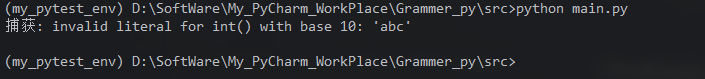

**注意**：

-   `try` 块应尽量**小**，只包裹可能出错的语句，避免掩盖无关错误。
-   不要用 `try` 包裹大量不相关逻辑，否则难以定位问题。


#### 2.2 `except` 块

用于捕获并处理异常。有多种形式。

##### 2.2.1 捕获特定异常

```python
try:
    x = 1 / 0
except ZeroDivisionError:
    print("除零错误")
```


##### 2.2.2 捕获并获取异常对象（`as`）

```python
try:
    x = int("abc")
except ValueError as e:
    print(f"异常类型: {type(e).__name__}")
    print(f"异常信息: {e}")
    print(f"异常参数: {e.args}")
```

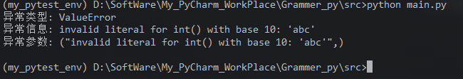

**重要细节**：`as e` 中的 `e` 在 `except` 块结束时会被**自动删除**（Python 3 行为），防止循环引用。

```python
try:
    x = int("abc")
except ValueError as e:
    pass
# print(e)   # NameError: name 'e' is not defined
```

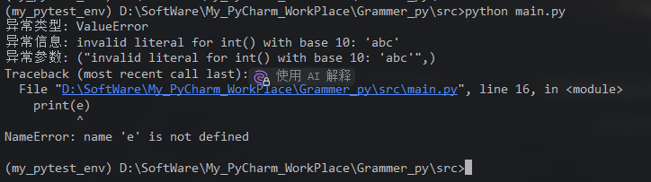


如需在 `except` 外使用，应提前赋值给其他变量：

```python
error = None
try:
    x = int("abc")
except ValueError as e:
    error = e
print(error)   # invalid literal for int() with base 10: 'abc'
```

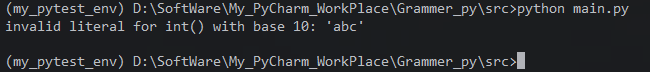


##### 2.2.3 捕获多个异常（元组）

```python
try:
    data = {"a": 1}
    value = data["b"]
except (KeyError, IndexError, ValueError) as e:
    print(f"数据访问失败: {e}")
```

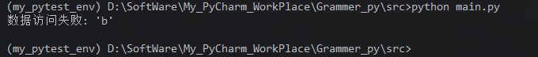


##### 2.2.4 多个 `except` 分支

```python
try:
    x = int("abc")
except ValueError as e:
    print(f"值错误: {e}")
except TypeError as e:
    print(f"类型错误: {e}")
except Exception as e:
    print(f"其他错误: {e}")
```

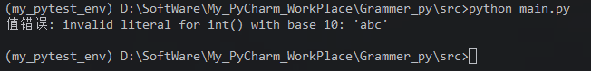


##### 2.2.5 匹配顺序：从上到下，第一个匹配的执行

`except` 按**书写顺序**匹配，第一个匹配的 `except` 执行，后续不再检查。

```python
try:
    x = int("abc")
except Exception as e:
    print("宽泛捕获先执行")
except ValueError as e:
    print("永远不会执行")
```

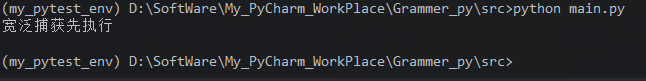

>    **原则**：**具体异常在前，宽泛异常在后**。


```python
try:
    x = int("abc")
except ValueError as e:
    print(f"值错误: {e}")       # 匹配
except Exception as e:
    print(f"其他错误: {e}")     # 不执行
```

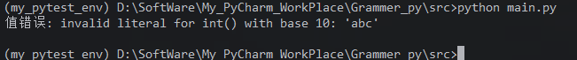


##### 2.2.6 裸 `except`（不推荐）

```python
try:
    risky()
except:   # 等价于 except BaseException
    pass
```

**问题**：

-   捕获所有异常，包括 `SystemExit`、`KeyboardInterrupt`、`GeneratorExit`。
-   导致 `Ctrl+C` 无法中断程序。
-   掩盖真正的错误，难以调试。

**替代**：

```python
try:
    risky()
except Exception as e:   # 只捕获普通异常
    handle(e)
```

只有在**极少数场景**（如日志记录后重新抛出）才考虑裸 `except`：

```python
try:
    risky()
except BaseException:
    logger.exception("发生异常")
    raise   # 重新抛出
```


##### 2.2.7 异常匹配基于继承

`except` 匹配的是**异常类及其子类**：


```python
try:
    open("不存在的文件.txt")
except OSError as e:
    print(f"OSError 捕获: {type(e).__name__}")
```

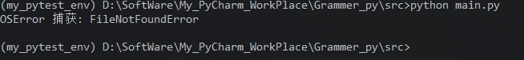

**输出**：`OSError 捕获: FileNotFoundError`

`FileNotFoundError` 是 `OSError` 的子类，被父类 `OSError` 捕获。


##### 2.2.8 在 `except` 中重新抛出

```python
try:
    process()
except ValueError as e:
    logger.warning(f"输入无效: {e}")
    raise   # 原样重新抛出
```

`raise` 不带参数时，重新抛出**当前正在处理的异常**，保留原始回溯信息。

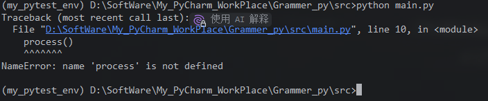


#### 2.3 `else` 块

`else` 块在 **`try` 块没有发生异常**时执行，**在 `finally` 之前**。

```python
try:
    result = risky_operation()
except Exception as e:
    print(f"失败: {e}")
else:
    print(f"成功: {result}")
```

##### 2.3.1 `else` 的意义

**核心作用**：将“成功后的处理”与“可能出错的代码”分离，避免误捕获 `else` 中的异常。

对比：

```python
# 不用 else：else 逻辑放在 try 中，其异常也会被 except 捕获
try:
    result = risky_operation()
    process_result(result)   # 这里出错也会被 except 捕获，可能不是预期
except Exception as e:
    print(f"失败: {e}")

# 用 else：只有 risky_operation 的异常被捕获
try:
    result = risky_operation()
except Exception as e:
    print(f"失败: {e}")
else:
    process_result(result)   # 这里的异常不会被上面的 except 捕获
```


##### 2.3.2 `else` 与 `return` 的交互

`else` 中的 `return` 与 `try` 中的 `return` 行为一致，`finally` 仍会执行。

```python
def f():
    try:
        return "try"
    except Exception:
        return "except"
    else:
        return "else"   # try 正常结束后执行，覆盖 try 的 return

print(f())   # else
```

**执行顺序**：

1.  `try` 中的 `return "try"` 准备返回，但被延迟。
2.  因为没有异常，执行 `else`，`return "else"` 覆盖之前的返回值。
3.  `finally` 执行（如果有）。
4.  最终返回 `"else"`。


#### 2.4 `finally` 块

`finally` 块**无论是否发生异常都会执行**，用于资源清理、关闭连接、释放锁等。

```python
f = None
try:
    f = open("data.txt")
    data = f.read()
except FileNotFoundError:
    print("文件不存在")
finally:
    if f:
        f.close()
    print("清理完成")
```

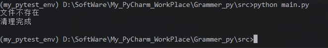


##### 2.4.1 `finally` 的保证

`finally` 在以下情况下都会执行：

-   `try` 正常结束。
-   `try` 中抛出异常，被 `except` 捕获。
-   `try` 中抛出异常，未被 `except` 捕获（异常在 `finally` 执行后继续传播）。
-   `try`/`except`/`else` 中有 `return`、`break`、`continue`。
-   `try` 中调用 `sys.exit()`。

```python
def f():
    try:
        return 1
    finally:
        print("finally 执行")

print(f())
# 输出：
# finally 执行
# 1
```

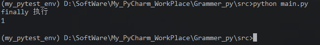


##### 2.4.2 `finally` 中不要 `return`

`finally` 中的 `return` 会**覆盖** `try`/`except`/`else` 中的返回值，甚至**吞掉异常**。

```python
def bad():
    try:
        raise ValueError("出错了")
    finally:
        return "finally"   # 吞掉异常，返回 "finally"

print(bad())   # finally（异常被吞）
```

**这通常不是期望的行为**，应避免在 `finally` 中 `return`。

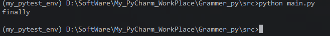


##### 2.4.3 `finally` 中的异常

如果 `finally` 中抛出异常，会**替换**原始异常（如果有）：

```python
try:
    try:
        raise ValueError("原始错误")
    finally:
        raise RuntimeError("finally 中的错误")
except RuntimeError as e:
    print(f"捕获: {e}")   # 捕获: finally 中的错误
```

原始 `ValueError` 会保存在 `RuntimeError.__context__` 中：

```python
try:
    try:
        raise ValueError("原始错误")
    finally:
        raise RuntimeError("finally 中的错误")
except RuntimeError as e:
    print(e.__context__)   # 原始错误
```


##### 2.4.4 `finally` 与 `break`/`continue`

`break`/`continue` 在 `try` 中触发时，`finally` 仍会执行。

```python
for i in range(3):
    try:
        if i == 1:
            continue
        print(f"处理 {i}")
    finally:
        print(f"清理 {i}")
```

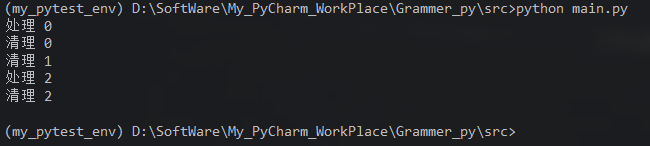


##### 2.4.5 `try/finally` 的等价 `with`

```python
# try/finally
f = open("data.txt")
try:
    data = f.read()
finally:
    f.close()

# 等价 with
with open("data.txt") as f:
    data = f.read()
```

`with` 更简洁，推荐用于资源管理。

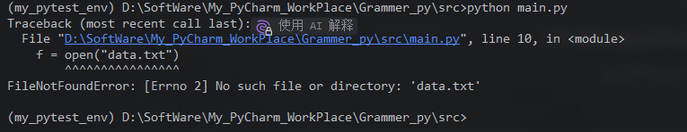


### 3、完整执行流程

#### 3.1 正常执行（无异常）

```python
try:
    print("try")
except Exception:
    print("except")
else:
    print("else")
finally:
    print("finally")
```

**输出**：

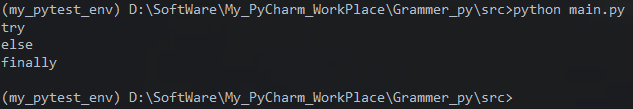

**流程**：`try` → `else` → `finally`


#### 3.2 发生异常并被捕获

```python
try:
    print("try")
    raise ValueError("出错了")
except ValueError:
    print("except")
else:
    print("else")
finally:
    print("finally")
```

**流程**：`try`（部分）→ `except` → `finally`。`else` 不执行。

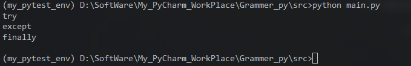


#### 3.3 发生异常但未被捕获


```python
try:
    print("try")
    raise ValueError("出错了")
except TypeError:
    print("except TypeError")
else:
    print("else")
finally:
    print("finally")
```

**流程**：`try`（部分）→ `finally` → 异常传播。`except` 不匹配，`else` 不执行。

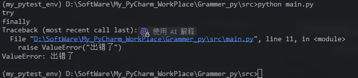


#### 3.4 异常匹配流程图

```text
           ┌─────────────┐
           │  执行 try   │
           └──────┬──────┘
                  │
        ┌─────────┴─────────┐
        │                   │
     无异常              有异常
        │                   │
        ▼                   ▼
   ┌─────────┐       ┌──────────────┐
   │ 执行 else│       │ 匹配 except?  │
   └────┬────┘       └──────┬───────┘
        │                   │
        │          ┌────────┴────────┐
        │          │                 │
        │        匹配              不匹配
        │          │                 │
        │          ▼                 │
        │    ┌──────────┐            │
        │    │ 执行 except│            │
        │    └────┬─────┘            │
        │         │                  │
        └─────────┴──────────────────┘
                  │
                  ▼
           ┌─────────────┐
           │ 执行 finally │
           └──────┬──────┘
                  │
                  ▼
         返回 / 继续 / 传播异常
```


### 4、`return` 与 `finally` 的交互

这是异常处理中最容易出错的部分。

#### 4.1 `try` 中 `return`，`finally` 执行

```python
def f():
    try:
        return "try"
    finally:
        print("finally 执行")

print(f())
# 输出：
# finally 执行
# try
```

**流程**：`return` 准备返回值 → 暂停返回 → 执行 `finally` → 真正返回。

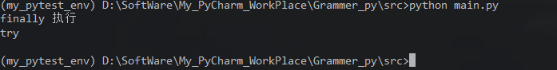


#### 4.2 `finally` 中 `return` 覆盖 `try` 的返回值

```python
def f():
    try:
        return "try"
    finally:
        return "finally"

print(f())   # finally
```

**原因**：`finally` 中的 `return` 会覆盖之前准备返回的值。

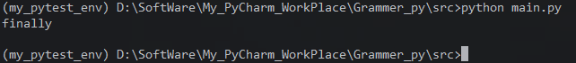


#### 4.3 `finally` 修改可变对象会影响返回值

```python
def f():
    result = []
    try:
        return result
    finally:
        result.append("modified")

print(f())   # ['modified']
```

**原因**：`return` 保存的是对象引用，`finally` 修改对象内容会影响返回值。

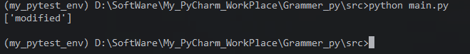

但重新赋值不可变对象不影响：

```python
def f():
    x = 1
    try:
        return x
    finally:
        x = 2   # 不影响返回值

print(f())   # 1
```

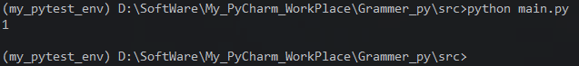


#### 4.4 `finally` 中 `break`/`continue` 的影响

```python
def f():
    for i in range(3):
        try:
            if i == 1:
                return i
        finally:
            continue   # 覆盖 return，继续循环

print(f())   # None（循环结束，无返回值）
```

`finally` 中的 `continue` 会**丢弃** `try` 中的 `return`，继续循环。


#### 4.5 总结表

| 场景                                     | 最终行为                                      |
| :--------------------------------------- | :-------------------------------------------- |
| `try` 中 `return`，`finally` 无 `return` | 返回 `try` 的值                               |
| `try` 中 `return`，`finally` 中 `return` | 返回 `finally` 的值                           |
| `try` 中 `raise`，`finally` 中 `return`  | 异常被吞，返回 `finally` 的值                 |
| `try` 中 `raise`，`finally` 中 `raise`   | 抛出 `finally` 的异常，原异常在 `__context__` |
| `finally` 修改可变对象                   | 影响返回值                                    |
| `finally` 重新赋值不可变对象             | 不影响返回值                                  |


## 12.3 捕获多个异常

## 12.4 异常的传播与重新抛出（raise）

## 12.5 自定义异常类

## 12.6 异常链（raise ... from ...）

## 12.7 断言（assert）与防御性编程

## 12.8 异常处理的最佳实践

## 12.9 上下文管理器与异常处理